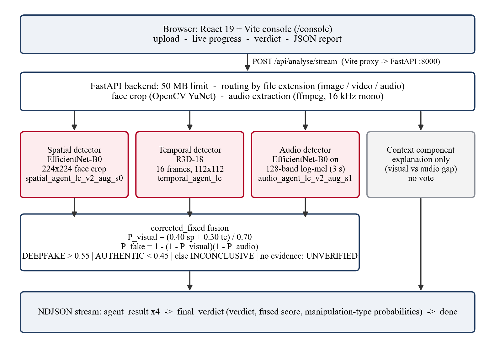
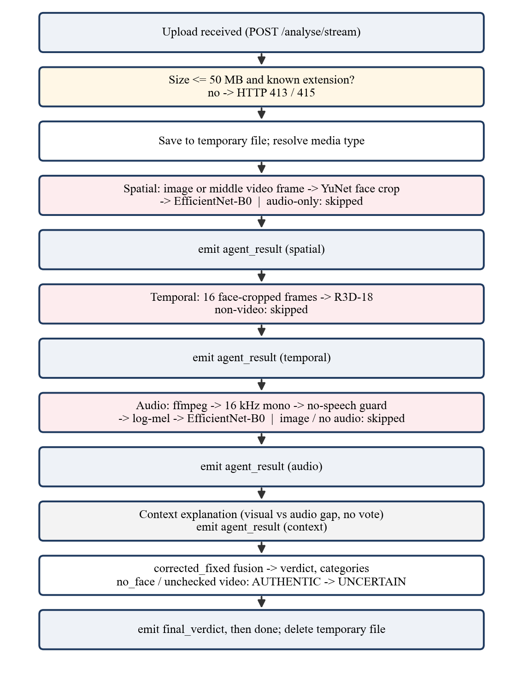
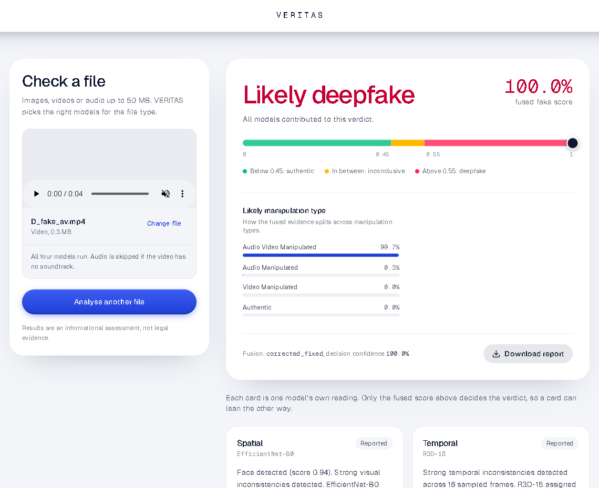
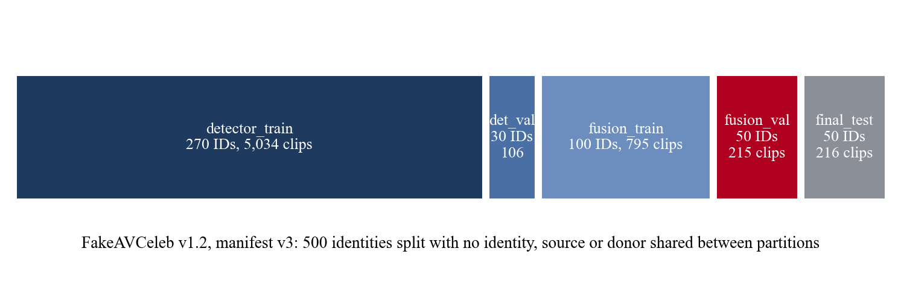
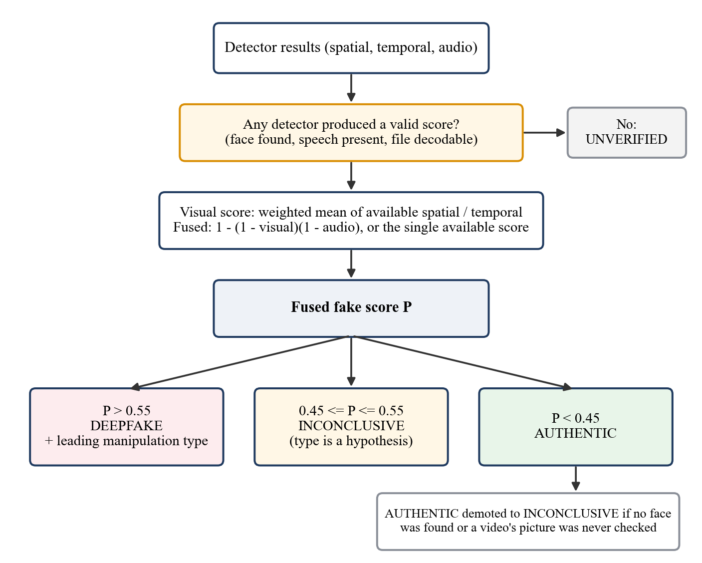
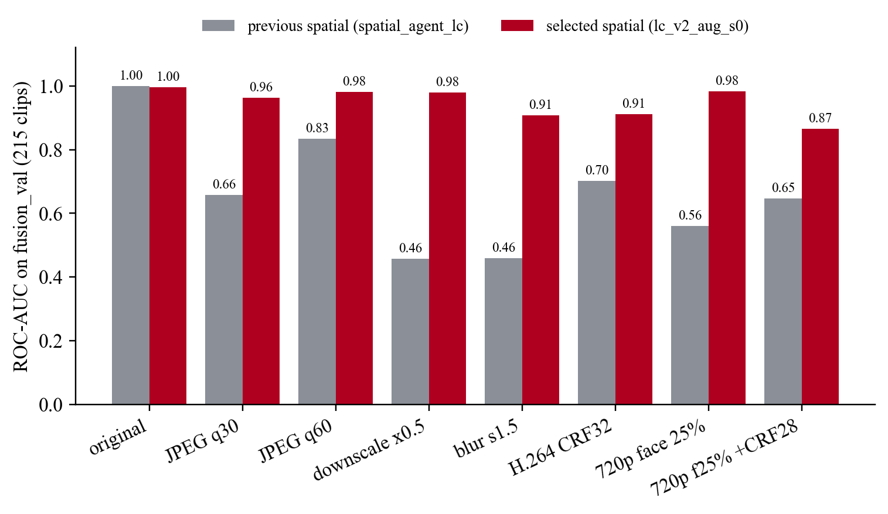
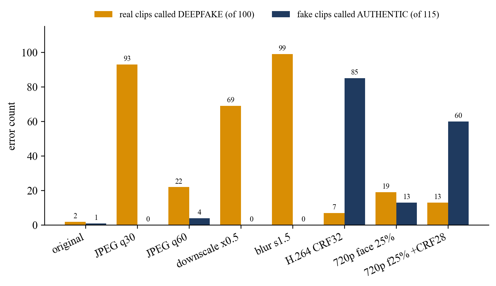
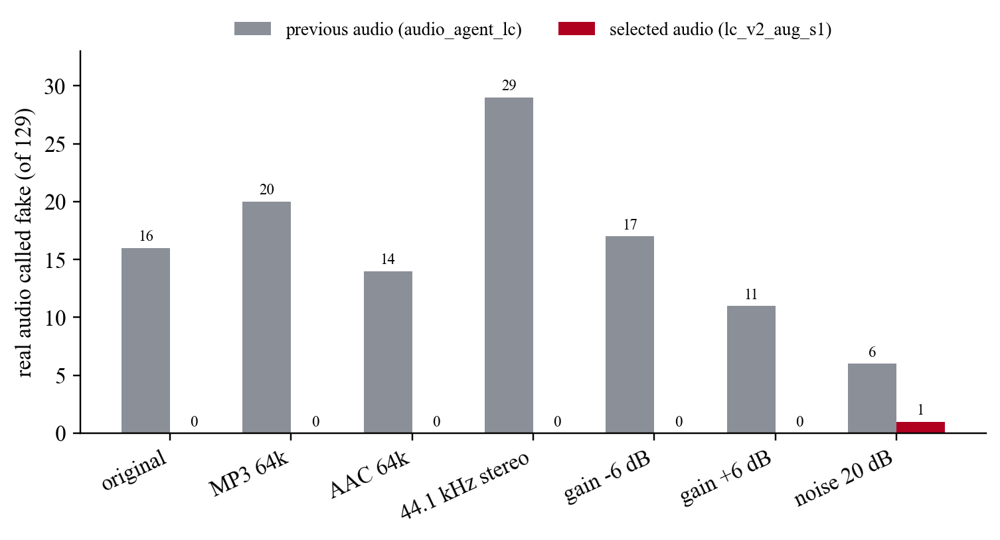
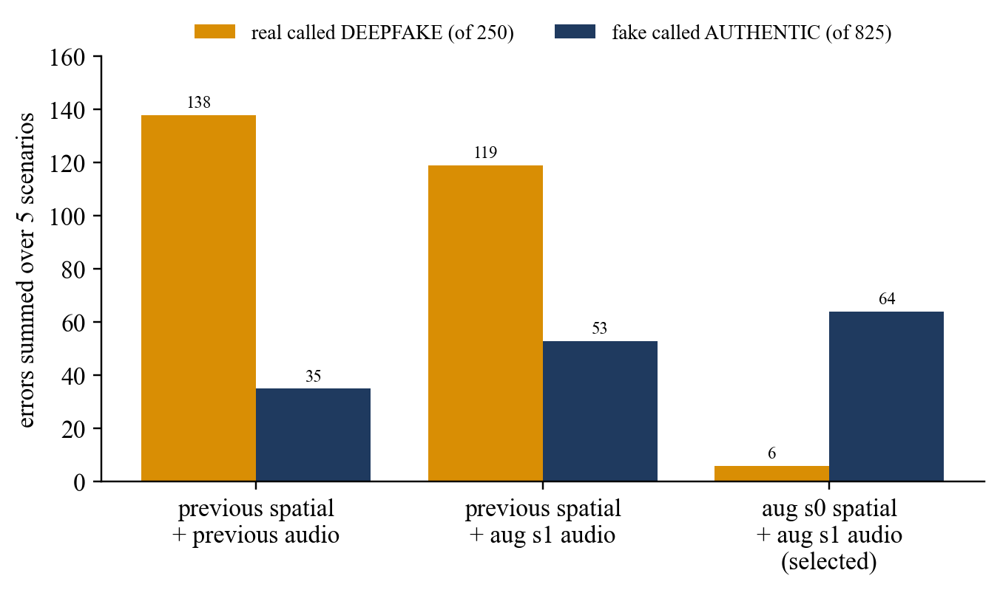

# VERITAS: Project Deep-Dive and Viva Preparation Guide

- **Project:** VERITAS: Multi-Agent Deepfake Detection and Reasoning
- **Team:** Harshil Kamde (A024), Siddhant Patil (A045), Tavis Fernandes (A117)
- **Faculty mentor:** Dr. Preeti Agarwal, Faculty Mentor, STME, NMIMS Navi Mumbai
- **Code state described:** branch `data-integrity-manifest-v2`, commit `fbe4281` (A.Y. 2026–2027)

## How to use this guide

This guide teaches the project from the ground up and then prepares you for the viva. Every technical statement about VERITAS was checked against the repository; file paths are relative to `veritas/` unless stated otherwise. Four kinds of statement appear, and they are labelled where it matters:

| Label | Meaning |
|---|---|
| **Implementation fact** | What the current code does. Verified in the named file. |
| **Recorded result** | A number from an evaluation file in `backend/training/` or from a test run. |
| **Illustration** | A hypothetical input chosen to explain a concept. The outputs shown for illustrations were computed by running the real fusion code, not by hand. |
| **Background / future work** | General theory, or something the project does not do yet. |

Each major component follows the same pattern: simple explanation, technical explanation, code walkthrough, why we chose it, example, strengths and weaknesses, and a likely viva question.

**Three facts to keep in mind throughout:**

1. All robustness and system-level numbers were measured on **fusion_val**, which was also used to choose the models. They are *development evidence*, not an independent estimate of real-world accuracy.
2. The **final_test** split has been scored repeatedly during the project and was used for browser-QA examples. It is **not** an untouched test set.
3. VERITAS has **no** Grad-CAM heatmaps at inference time, **no** lip-sync detector, and its Context component **does not predict anything**. Some older documents (the README and the runbook's demo section) still describe an earlier version; Section 24.12 lists these conflicts.

---

# PART I — UNDERSTANDING THE PROJECT FROM ZERO

# Chapter 1: The Project in Simple Language

## 1.1 What is a deepfake?

**Simple:** a deepfake is a picture, video or sound recording that a computer program has changed or created so that it looks or sounds real, but shows something that never happened, for example a person saying words they never said.

**Technical:** a deepfake is synthetic or manipulated media produced by a generative machine-learning model. The common families are:

- **Face swap** (identity swap): a source person's face is placed onto a target person's head in each frame. FakeAVCeleb, our dataset, uses *FaceSwap* and *FSGAN*.
- **Lip-sync / reenactment:** the mouth region of a real video is re-animated to match different speech. FakeAVCeleb uses *Wav2Lip*.
- **Voice cloning / speech synthesis:** a model generates speech in a target person's voice. FakeAVCeleb uses a real-time voice-cloning system (*RTVC*).
- **Fully synthetic images** (e.g., GAN or diffusion faces). VERITAS was **not** trained on these.

**How the media types differ**

| Media | What is manipulated | Where the evidence is |
|---|---|---|
| Image | Pixels of one frame | Blending seams, texture, lighting inconsistencies |
| Video | A sequence of frames | Single-frame artefacts **plus** frame-to-frame flicker or unnatural motion |
| Audio | The waveform | Spectral artefacts from synthesis or voice conversion |
| Video with audio | Picture, sound, or both | Any of the above, and possibly disagreement between them |

## 1.2 Why detection is hard

- Generators keep improving; artefacts that one detector learns may be absent in the next generator's output.
- Real-world media is **re-encoded** (WhatsApp, YouTube, social media). Compression, resizing and blur destroy or imitate the subtle artefacts detectors rely on. This is the central difficulty measured in our results.
- A detector trained on one dataset learns that dataset's quirks; it can look excellent on familiar data and fail elsewhere (generalisation problem).
- One file can be manipulated in one modality but not another, so a single-modality detector can miss the manipulation entirely.

## 1.3 The problem VERITAS addresses

A person who receives a suspicious clip does not know whether the face, the voice, or both were faked, and does not know which tool to use. VERITAS accepts **an image, a video, or an audio file**, runs every analysis that applies, and returns one combined verdict, a manipulation-type estimate, and each detector's finding. When evidence is weak or missing it **abstains** ("Inconclusive" or "Can't verify") instead of guessing.

**Who would use it:** content-moderation teams (triage), journalists and fact-checkers (preliminary check), forensic analysts (deciding which modality to examine), and teachers or researchers. In all cases it is **decision support for human review**, not proof.

**What the output means:** a *fused fake score* between 0 and 1 placed on a scale with boundaries at 0.45 and 0.55; a *verdict* (Likely authentic / Inconclusive / Likely deepfake / Can't verify); a *manipulation type* (authentic, audio manipulated, video manipulated, audio-and-video manipulated); and one card per detector explaining what it saw.

## 1.4 Why one model is not enough

A face-frame classifier cannot hear a cloned voice; an audio classifier cannot see a swapped face; a single frame cannot show flicker over time. VERITAS therefore uses **three specialist detectors** (spatial, temporal, audio), each trained for one kind of evidence, and a **fusion rule** that combines whatever evidence is available.

## 1.5 What makes it "multimodal" and "multi-agent"

- **Multimodal:** it analyses more than one kind of data (visual frames, video motion, audio).
- **Multi-agent (as used in this project):** each analysis is a separate component (the code calls them *agents*: Spatial, Temporal, Audio, Context) with its own input, model and output; an orchestrator in `backend/main.py` runs them in order and fusion combines them. They are *not* autonomous agents that negotiate or learn from each other. If an examiner asks, say: "multi-agent here means modular independent analysers coordinated by an orchestrator; it does not mean reinforcement-learning agents interacting with each other." (The experimental PPO fusion does use reinforcement learning, but it is not the default.)

## 1.6 "Is it fake?" versus "how was it faked?"

- **Detection** = the fused fake score and verdict: is there evidence of manipulation?
- **Attribution** = the manipulation type: which modality appears manipulated? VERITAS estimates this from the visual and audio scores. Attribution is *weaker* than detection: when compression weakens the visual evidence, an audio-and-video fake can be labelled "audio manipulated" even though the verdict "deepfake" is correct (Section 17.6).

## 1.7 What VERITAS can and cannot do today

| Can (implemented and tested) | Cannot / not implemented |
|---|---|
| Accept images, videos (with/without audio), audio files up to 50 MB | Prove authenticity or provide legal evidence |
| Find and crop the face before visual analysis | Analyse media without a detectable face visually |
| Score face frames (EfficientNet-B0), 16-frame clips (R3D-18), speech (mel-spectrogram CNN) | Detect lip-sync mismatch with a dedicated model |
| Fuse available evidence; abstain inside 0.45–0.55; report "Can't verify" when nothing usable exists | Produce Grad-CAM heatmaps (code exists but is not called) |
| Stream progress; download a JSON report | Give a calibrated probability of being correct |
| Reject silence and pure tones as non-speech | Reliably reject music or noise (still scored) |
| Roll back spatial/audio checkpoints with environment variables | Claim an independent real-world accuracy figure |

## 1.8 Ready-made explanations

**30 seconds.** "VERITAS is a deepfake detection system for images, videos and audio. It runs three specialist neural networks: one looks at the face in a frame, one looks at motion across sixteen frames, and one listens to the voice through a mel spectrogram. A transparent fusion rule combines whatever evidence is available into one fake score and a verdict, and the system says *inconclusive* or *can't verify* instead of guessing when the evidence is weak or missing."

**One minute.** Add: "A face-swap and a cloned voice leave different traces, so one model is not enough. We trained the detectors on an identity-disjoint split of FakeAVCeleb, so no celebrity appears in both training and evaluation, and we found and fixed data problems such as an audio cache that paired 313 files with the wrong audio. We retrained the spatial and audio detectors with compression and noise augmentation, which made them much more robust to re-encoding. The web console streams each detector's result as it finishes and shows the fused verdict and manipulation type. Our honest limitation is that the temporal detector is still weak under compression, and our numbers are development results, not real-world accuracy."

**Three minutes.** Use the one-minute version, then walk through the pipeline: (1) the React console uploads the file to FastAPI; (2) the backend routes by file type; (3) the YuNet face detector crops the face; the spatial model scores the middle frame at 224×224, the temporal model scores 16 frames at 112×112, and the audio model scores the centre 3 seconds as a 128-band log-mel spectrogram; (4) the Context component only restates whether visual and audio agree; (5) fusion computes `visual = (0.40·spatial + 0.30·temporal)/0.70` and `fake = 1 − (1 − visual)(1 − audio)`; above 0.55 is deepfake, below 0.45 authentic, in between inconclusive; (6) results stream back as NDJSON and the console shows the verdict, scale and manipulation type. Finish with the results: on our development split, false deepfake calls on degraded real clips fell from 119 to 6 of 250, at the cost of more missed visual-only fakes after heavy compression (53 to 64 of 825), and the temporal detector is the next thing to retrain.

---

# Chapter 2: Problem Statement, Objectives and Contributions

## 2.1 Problem statement

Design and implement a multimodal deepfake detection and reasoning system that accepts images, videos and audio; analyses spatial, temporal and audio evidence with dedicated neural detectors; combines the available evidence into one verdict with a manipulation-type estimate; abstains when the evidence is insufficient or absent; explains each detector's contribution; and is evaluated with a leakage-controlled, identity-disjoint protocol that reports its limitations, especially behaviour on compressed media.

## 2.2 Objectives

1. Spatial detector for faces in images and video frames.
2. Temporal detector for face videos.
3. Audio detector for speech.
4. Fusion that handles any subset of modalities, with abstention and manipulation types.
5. Streaming web console with a downloadable JSON report.
6. Identity-disjoint training and robustness evaluation with recorded data provenance.

## 2.3 Scope

In scope: the three detectors, fusion, the API, the console, training on FakeAVCeleb, robustness evaluation. Out of scope: building generators, legal-grade forensics, certification on other generators, production deployment (authentication, scaling).

## 2.4 Requirements

**Functional (verified in code):**

| ID | Requirement | Where |
|---|---|---|
| FR-1 | Accept the listed image/video/audio extensions, max 50 MB; reject others | `backend/main.py` `_detect_media_type`, `_resolve_media_type`; `frontend/src/pages/Console.tsx` `EXTS`, `MAX_BYTES` |
| FR-2 | Run only the detectors that apply to the file type | `main.py` `_stream_agents` |
| FR-3 | Report skipped detectors with a reason | detector result dicts (`status`, `finding`) |
| FR-4 | Fuse available scores into fake score, verdict, four category probabilities | `fusion_policy.compute_verdict_corrected_fixed` |
| FR-5 | Inconclusive band 0.45–0.55; UNVERIFIED with no evidence | same + `decision_contract.py` |
| FR-6 | Stream each result as it is ready | `main.py` `analyse_stream`, `frontend/src/lib/ndjson.ts` |
| FR-7 | Download a JSON report | `Console.tsx` `downloadReport` |

**Non-functional:** CPU inference (no GPU required); upload rejected early if too large (`RejectOversizedRequests`); localhost binding by default (no authentication); checkpoints selectable by name for rollback; never invent a score for a missing model; temporary files always deleted.

## 2.5 Why each part is needed

| Part | Why |
|---|---|
| Spatial analysis | Face-swap blending and texture artefacts are visible in single frames. |
| Temporal analysis | Frame-by-frame generation causes flicker and motion inconsistency invisible in one frame. |
| Audio analysis | Cloned voices leave spectral artefacts; visual models cannot hear them. |
| Fusion | One answer is needed, and missing modalities must not silently count as "authentic". |
| Detector explanations | Reviewers need to see *which* evidence drove the result. |
| Unsupported/unverifiable handling | A file with no face and no speech has not been assessed; calling it authentic would be false reassurance. |

## 2.6 Our contributions versus reused components

| Reused (standard, not our invention) | Our work |
|---|---|
| EfficientNet-B0 and R3D-18 architectures, ImageNet / Kinetics pre-trained weights (torchvision) | Integrating three detectors into one routed, streaming application |
| YuNet face detector (OpenCV) | Face-crop framing that reproduces the training clips (`face_crop.py`) |
| Mel spectrogram (torchaudio), ffmpeg | Identity-disjoint 5-way split; dataset audit (26 mislabelled duplicates, 11 duplicate rows, 313 wrong-audio cache entries) |
| FastAPI, React, Vite | Degradation-augmented retraining of spatial and audio detectors; robustness evaluation and documented trade-off |
| FakeAVCeleb dataset | `corrected_fixed` fusion rule with abstention and UNVERIFIED handling; no-speech guard; demotion of unchecked AUTHENTIC; UI fix for unverifiable results |
| Fusion idea of combining probabilities | Honest evaluation protocol with evidence labels |

**Viva question.** *"What is novel here?"* — **Answer:** "The individual architectures are standard. Our contribution is the system: modality-aware routing of three detectors, a transparent fusion rule that abstains and refuses to call unassessed media authentic, a cleaned identity-disjoint data protocol, robustness-oriented retraining with a measured trade-off, and an honest evaluation. We don't claim a new state-of-the-art detector."

---

# PART II — SYSTEM ARCHITECTURE AND COMPLETE FLOW

# Chapter 3: The Entire Architecture



*Figure 3.1: Architecture as implemented (backend `main.py` orchestrates the agents; fusion in `fusion_policy.py`).*

## 3.1 Components

| Component | Runs in | File | Input | Output |
|---|---|---|---|---|
| Analysis console | Browser | `frontend/src/pages/Console.tsx` | User's file | Multipart POST; renders stream |
| NDJSON reader | Browser | `frontend/src/lib/ndjson.ts` | Response body stream | One JS object per line |
| Dev proxy | Vite (Node) | `frontend/vite.config.ts` | `/api/...` | Forwards to `http://127.0.0.1:8000/...` (prefix stripped) |
| API + orchestrator | Backend | `backend/main.py` | Multipart upload | NDJSON events / JSON |
| Size guard | Backend | `main.py` `RejectOversizedRequests` | Request headers | HTTP 413 if too large |
| Face detection & crop | Backend | `backend/face_crop.py` | BGR frame | Face box or reason; square crop |
| Spatial detector | Backend | `backend/spatial_agent.py` `predict` | Image path | Result dict (score 0–1) |
| Temporal detector | Backend | `backend/temporal_agent.py` `run_temporal_agent` | Video path | Result dict |
| Audio detector | Backend | `backend/audio_agent.py` `run_audio_agent` | Media path | Result dict |
| Context explanation | Backend | `backend/mock_agents.py` `context_agent_result` | Other three results | Explanation dict (never a vote) |
| Fusion | Backend | `backend/fusion_policy.py` `compute_verdict_corrected_fixed` | Agent list | Score, verdict, categories |
| Decision contract | Backend | `backend/decision_contract.py` `enrich_decision_fields` | Fusion details | Thresholds, decision confidence, verdict class |
| Report | Browser | `Console.tsx` `downloadReport` | Verdict + agent states | JSON file download |

(`mock_agents.py` keeps its historical name; the Context function inside it is real and explanation-only.)

## 3.2 Browser versus backend

Runs in the **browser**: file selection, extension and 50 MB checks, preview, streaming parser, progress bar, detector cards, verdict panel, report download. Runs on the **backend**: media-type resolution, temporary file storage, face detection, frame and audio extraction, all neural-network inference, fusion, deletion of temporary files.

## 3.3 How data flows

Upload → temporary file → (image or middle video frame → face crop → spatial) → (16 frames → face crop → temporal) → (ffmpeg → 16 kHz mono WAV → no-speech check → log-mel → audio) → context explanation → fusion → `final_verdict` → `done`. Each detector returns a Python dict; the orchestrator appends it to `agents_done` and streams it; fusion receives the full list.

## 3.4 Missing modalities and unusable evidence

A detector that does not apply or cannot work returns `is_fake: None` with a `status` explaining why (`not_applicable`, `no_audio`, `no_face`, `unavailable`, `untrained`, `error`). Fusion treats a detector as **valid only if `is_fake is not None` and its status is not in the unavailable set** (`fusion_policy.extract_state_from_agents`). Invalid detectors are left out of the formula, listed as `unavailable_agents`, and never counted as "authentic". If no detector is valid, the result is `UNVERIFIED MODALITY` ("Can't verify").

## 3.5 Implemented versus future

Implemented: everything in Figure 3.1. Future: temporal retraining with augmentation, independent evaluation set, Grad-CAM (helper `_compute_gradcam` exists in `spatial_agent.py` but is never called), lip-sync / audio-visual consistency model, calibration, authentication and production deployment, PPO retraining on the current detectors.

---

# Chapter 4: End-to-End Walkthrough



*Figure 4.1: Processing flow of `POST /analyse/stream`.*

## 4.1 Step by step through the code

| # | Step | File : symbol | Input → Output | Next |
|---|---|---|---|---|
| 1 | User picks or drops a file | `Console.tsx` `pickFile` (via `<input id="console-file">` or `dropProps.onDrop`) | `File` → checks `mediaKind(file)` against `EXTS`, size ≤ `MAX_BYTES` (50 MB); sets `selectedFile` or `fileError` | Preview + "Analyse file" |
| 2 | Submit | `Console.tsx` `startAnalysis` | `FormData` with field `file` → `fetch('/api/analyse/stream', {method:'POST'})` | Vite proxy |
| 3 | Proxy | `vite.config.ts` `server.proxy['/api']` | rewrites `/api/analyse/stream` → `http://127.0.0.1:8000/analyse/stream` | FastAPI |
| 4 | Size guard | `main.py` `RejectOversizedRequests.__call__` | `Content-Length` > 51 MB → 413 JSON | route |
| 5 | Route | `main.py` `analyse_stream` | `_resolve_media_type(filename, media_type)` → `image`/`video`/`audio` or 415; reads bytes, 413 if > 50 MB; writes `tempfile.mkstemp` | `generate()` |
| 6 | Spatial | `_stream_agents` → `spatial_agent.predict` (video: `_extract_video_frame` first) | image path → `{"status":"trained","confidence":p,...}` or `no_face` | yield `agent_result`; `asyncio.sleep(0.4)` |
| 7 | Temporal | `run_temporal_agent` (video only) | video → 16 frames → R3D-18 → result dict | yield; sleep 0.4 |
| 8 | Audio | `run_audio_agent` (not for images) | probe → ffmpeg WAV → no-speech check → log-mel → model | yield; sleep 0.4 |
| 9 | Context | `context_agent_result(s, t, a)` | three dicts → explanation dict | yield |
| 10 | Fusion | `_compute_verdict` → `compute_verdict_corrected_fixed` → `enrich_decision_fields`; then the no-face / unchecked-video demotion | agent list → `(overall, verdict, contributing, unavailable, details)` | yield `final_verdict` |
| 11 | Done | `_stream_agents` | — | yield `{"type":"done"}`; `generate()`'s `finally` deletes the temp file |
| 12 | Browser parses | `ndjson.ts` `readNdjson` callback in `startAnalysis` | each line → updates `agents` / `verdict` state | re-render |
| 13 | Report | `downloadReport` | file info + `verdict` + `agents` (minus `gradcam_b64`) → `veritas-report-<name>.json` | — |

Model inference runs inside `asyncio.get_event_loop().run_in_executor(None, ...)` so the server's event loop is not blocked while a model runs.

## 4.2 Six numbers that are easy to confuse

| Term | Where it comes from | Example |
|---|---|---|
| **Detector score** (`confidence` in an agent result) | One model's fake probability (softmax or sigmoid) | spatial 0.984 |
| **Fused fake score** (`fake_probability`, `overall_confidence`) | Fusion formula over valid detectors | 0.9971 |
| **Decision threshold** | Fixed: τ = 0.50 with band 0.45–0.55 | — |
| **Verdict** (`verdict`, `verdict_class`) | Fused score compared with 0.45 / 0.55, plus abstention rules | DEEPFAKE |
| **Manipulation category** (`predicted_category`, `category_probabilities`) | Products of visual and audio scores | AUDIO_VIDEO_MANIPULATED 0.876 |
| **Decision confidence** (`decision_confidence`) | Distance of the fused score from the nearest band edge, scaled to 0–1 | 0.994 |
| **Unavailable detector** | `is_fake: None` or unavailable status | `no_audio` |
| **Inconclusive** | Fused score in [0.45, 0.55] or demoted AUTHENTIC | — |
| **Unverifiable** | No valid detector at all | pure tone |

## 4.3 Walkthroughs by input type

These use the recorded browser-QA runs (selected final_test FakeAVCeleb samples and synthetic files, run on the code that became commit `fbe4281`).

**Image (frame of a FaceSwap video).** Spatial: face found (score 0.95), fake probability 0.984 → `trained`. Temporal: `not_applicable`. Audio: `no_audio` ("not applicable to image media"). Context: `not_applicable` (only one modality). Fusion: visual = 0.984, no audio → fused 0.984 → DEEPFAKE; categories: video manipulated 0.984, authentic 0.016. Console: "Likely deepfake 98.4%".

**Video with audio (FakeVideo-FakeAudio, FaceSwap + Wav2Lip).** Spatial 0.998, temporal 0.996, audio ≈1.000; context "point the same way". Fused 1.000 → DEEPFAKE, category audio-and-video manipulated 99.7%.

**Video without audio (FakeVideo, audio stripped).** Spatial 0.257, temporal 0.989, audio `no_audio`. Visual = (0.40·0.257 + 0.30·0.989)/0.70 = 0.571 → fused 0.571 → DEEPFAKE (just above 0.55). This shows how the temporal model can carry a decision when the single frame looks clean.

**Audio only (cloned-voice WAV).** Spatial and temporal `not_applicable`; audio ≈1.000 → DEEPFAKE, category audio manipulated.

**No face / no speech (grey video with a 440 Hz tone).** Spatial and temporal `no_face`; audio `unavailable` ("pure tone, not speech"); context "no modality verdicts". Fusion: no valid detector → `UNVERIFIED MODALITY`. Console: "Can't verify", no score (after the `fbe4281` fix).

**Detectors disagree (illustration, real fusion output).** Spatial 0.10, temporal 0.05, audio 0.98 → visual 0.0786, fused 0.9816 → DEEPFAKE, category audio manipulated 0.903. The context finding says the scores "point in different directions, a gap of 90%". This is the RealVideo-FakeAudio pattern: the face is genuine, the voice is cloned.

---

# PART III — IMPORTANT CODE EXPLAINED

# Chapter 5: Repository Structure and Important Files

```text
veritas/
├── backend/
│   ├── main.py                 FastAPI app, routing, orchestration, streaming, fusion call
│   ├── spatial_agent.py        EfficientNet-B0 spatial detector (load_model, predict)
│   ├── temporal_agent.py       R3D-18 temporal detector (load_model, run_temporal_agent)
│   ├── audio_agent.py          Mel-spectrogram EfficientNet-B0 audio detector (run_audio_agent)
│   ├── face_crop.py            YuNet face detection + training-style crop (detect, crop)
│   ├── mock_agents.py          Context explanation (context_agent_result) — explanation only
│   ├── fusion_policy.py        corrected_fixed, legacy and experimental PPO fusion
│   ├── decision_contract.py    Thresholds, verdict classes, decision confidence, metric helpers
│   ├── conftest.py             Tells pytest which test files are standalone scripts
│   ├── test_*.py               85 pytest tests + 12 standalone test scripts
│   ├── models/                 Checkpoints (*.pth) and YuNet ONNX model
│   └── training/               Training/eval scripts, manifests, result reports
├── frontend/
│   ├── vite.config.ts          Dev server on 127.0.0.1:5173; /api proxy to :8000
│   └── src/
│       ├── pages/Console.tsx   The analysis console (all analysis UI logic)
│       ├── lib/ndjson.ts       Streaming NDJSON reader (+ ndjson.test.ts)
│       └── App.tsx             Routes: "/" (landing) and "/console"
├── README.md, PRESENTATION_RUNBOOK.md
```

| File | Key symbols | Called by | Calls | If removed or changed |
|---|---|---|---|---|
| `backend/main.py` | `app`, `RejectOversizedRequests`, `startup_event`, `_loaded_models`, `_detect_media_type`, `_resolve_media_type`, `_extract_video_frame`, `_build_agents`, `_compute_verdict`, `_stream_agents`, `healthz`, `analyse`, `analyse_stream`, `_build_summary`, `_decision_payload` | uvicorn | every agent, fusion, contract | The service does not exist |
| `backend/spatial_agent.py` | `_CHECKPOINT_NAME`, `_TRANSFORM`, `_build_model`, `load_model`, `predict`, `_make_finding`, `_compute_gradcam` (unused) | `main.py` | `face_crop` | No spatial evidence; architecture must match checkpoint |
| `backend/temporal_agent.py` | `_NUM_FRAMES=16`, `_FRAME_SIZE=(112,112)`, `_DECISION_THRESHOLD` (from checkpoint), `load_model`, `_extract_frames`, `run_temporal_agent` | `main.py` | `face_crop` | No temporal evidence |
| `backend/audio_agent.py` | `_CHECKPOINT_NAME`, `_SAMPLE_RATE=16000`, `_CLIP_SAMPLES=48000`, `_MEL_TRANSFORM`, `_probe_audio_stream`, `_extract_wav`, `_no_speech_reason`, `_wav_to_tensor`, `run_audio_agent` | `main.py` | `imageio_ffmpeg`, torchaudio | No audio evidence; preprocessing must match training |
| `backend/face_crop.py` | `FACE_TO_CROP=0.708`, `FACE_CY=0.367`, `MIN_SCORE=0.7`, `MIN_FACE_PX=64`, `detect`, `crop` | spatial, temporal | OpenCV `FaceDetectorYN` | Visual models see un-framed faces → worse scores |
| `backend/mock_agents.py` | `_visual_fake_prob`, `context_agent_result` | `main.py` | — | Context card disappears; verdict unchanged |
| `backend/fusion_policy.py` | `extract_state_from_agents`, `compute_verdict_corrected_fixed`, `compute_verdict_legacy`, `PPOFusionPolicy`, `get_fusion_policy` | `main._compute_verdict` | `decision_contract` | No verdict |
| `backend/decision_contract.py` | `CATEGORIES`, `DEFAULT_DEADBAND=0.05`, `CORRECTED_FIXED_TAU*`, `normalize_verdict_class`, `decision_confidence_from_scores`, `enrich_decision_fields` | fusion, `main.py` | numpy | Decision fields missing from responses |
| `frontend/src/pages/Console.tsx` | `AgentResult`, `Verdict`, `EXTS`, `MAX_BYTES`, `mediaKind`, `pickFile`, `startAnalysis`, `downloadReport`, `VerdictPanel`, `ScoreScale`, `Bars`, `AgentCard` | `App.tsx` route `/console` | `readNdjson` | No console |
| `frontend/src/lib/ndjson.ts` | `readNdjson` | `Console.tsx` | browser Streams API | Stream never parsed |
| `frontend/vite.config.ts` | `server.host`, `server.proxy['/api']` | Vite | — | Browser cannot reach backend in development |

---

# Chapter 6: Backend Walkthrough

## 6.1 Startup and model loading

**Simple:** when the server starts, it loads the three neural networks into memory once, so each upload does not wait for loading.

```python
# backend/main.py
@app.on_event("startup")
async def startup_event() -> None:
    logger.info("Starting VERITAS backend service …")
    try:
        spatial_agent.load_model()
    except Exception as _se:
        logger.error("Spatial Agent startup error: %s", _se)
    try:
        import temporal_agent as _ta
        if not _ta._model_loaded:
            _ta.load_model()
    ...
    for name, loaded in _loaded_models().items():
        logger.info("Detector checkpoint: %s", f"{name} = {loaded}")
```

Line by line: the decorator registers a function FastAPI runs once at start-up. Each `load_model()` is wrapped in `try/except`, so a missing checkpoint logs an error instead of crashing the server; that detector then reports itself unavailable for every request. Temporal and audio may already have loaded when their modules were imported, so the code checks `_model_loaded` first. The final loop logs which checkpoint file each detector loaded. (`@app.on_event` is deprecated in newer FastAPI; it still works here, and it causes the deprecation warnings in the pytest output.)

**Checkpoint selection** (implementation fact):

```python
# backend/spatial_agent.py
_CHECKPOINT_NAME = os.environ.get("VERITAS_SPATIAL_CHECKPOINT", "spatial_agent_lc_v2_aug_s0.pth")
# backend/audio_agent.py
_CHECKPOINT_NAME = os.environ.get("VERITAS_AUDIO_CHECKPOINT", "audio_agent_lc_v2_aug_s1.pth")
# backend/temporal_agent.py  (hard-coded, no environment override)
_HERE / "models" / "temporal_agent_lc.pth"
```

`os.environ.get(NAME, default)` reads an environment variable and falls back to the default file name. This is the rollback mechanism: setting `VERITAS_SPATIAL_CHECKPOINT=spatial_agent_lc.pth` before starting the backend restores the previous spatial model without code changes. **The temporal checkpoint has no such variable.**

## 6.2 `/healthz`

```python
@app.get("/healthz")
async def healthz() -> dict:
    return {"status": "ok", "models": _loaded_models()}
```

`_loaded_models()` returns the file name each detector loaded, or `None` if it failed. Recorded response on the demo machine: `{"status":"ok","models":{"spatial":"spatial_agent_lc_v2_aug_s0.pth","temporal":"temporal_agent_lc.pth","audio":"audio_agent_lc_v2_aug_s1.pth"}}`. Use it before every demo.

## 6.3 Upload validation

```python
_MAX_REQUEST_BYTES = 50 * 1024 * 1024 + 1024 * 1024

class RejectOversizedRequests:
    async def __call__(self, scope, receive, send):
        if scope["type"] == "http":
            length = dict(scope["headers"]).get(b"content-length", b"")
            if length.isdigit() and int(length) > _MAX_REQUEST_BYTES:
                response = JSONResponse({"detail": "File exceeds 50MB limit."}, status_code=413)
                return await response(scope, receive, send)
        await self.app(scope, receive, send)
```

**Simple:** before reading a huge upload, check the size the browser announced; refuse if it is over about 51 MB. **Technical:** this is ASGI middleware; it inspects the `Content-Length` header and returns HTTP 413 without reading the body. The extra 1 MB allows for multipart framing. Because `Content-Length` can be absent (chunked uploads), the routes also check `len(contents) > 50 MB` after reading.

```python
def _resolve_media_type(filename: str, hint: str) -> str:
    hint = hint.strip().lower()
    resolved = hint if hint in ("image", "video", "audio") else _detect_media_type(filename)
    if resolved is None:
        raise HTTPException(status_code=415, detail=f"Unsupported file type ...")
    return resolved
```

The optional form field `media_type` can force a type; otherwise the extension decides (`_IMAGE_EXTS`, `_VIDEO_EXTS`, `_AUDIO_EXTS`). Unknown types get **415 Unsupported Media Type** instead of being guessed. **Limitation:** routing is by extension, not by inspecting the file's contents; a renamed file is routed by its new name (the temporal detector does reject a "video" with fewer than 16 frames).

## 6.4 The streaming orchestrator

```python
async def _stream_agents(tmp_path, resolved_media_type, mode_override=""):
    agents_done = []
    # 1. Spatial
    if resolved_media_type == "audio":
        s_result = {"agent": "Spatial Analysis", "status": "not_applicable", "confidence": 0.0, "is_fake": None, ...}
    elif resolved_media_type == "video":
        frame_path = _extract_video_frame(tmp_path)
        s_result = await asyncio.get_event_loop().run_in_executor(None, spatial_agent.predict, frame_path)
        s_result.setdefault("status", "trained")
    else:
        s_result = await asyncio.get_event_loop().run_in_executor(None, spatial_agent.predict, tmp_path)
    agents_done.append(s_result)
    yield json.dumps({"type": "agent_result", **s_result}) + "\n"
    await asyncio.sleep(0.4)
    # 2. Temporal (video only)  3. Audio (not for images)  4. Context
    ...
    overall_confidence, verdict, contributing, unavailable, details = _compute_verdict(agents_done, resolved_media_type, return_details=True, ...)
    yield json.dumps({"type": "final_verdict", "verdict": verdict, "overall_confidence": overall_confidence, ...}) + "\n"
    yield json.dumps({"type": "done"}) + "\n"
```

(Abridged; exception branches that return `status: "error"` dicts are omitted.)

- `async def ... yield` makes an **async generator**: each `yield` sends one line to the browser immediately.
- `run_in_executor(None, f, arg)` runs the blocking PyTorch call in a worker thread so the server stays responsive.
- `json.dumps({...}) + "\n"` is one NDJSON line. `**s_result` copies the detector's fields into the event.
- `asyncio.sleep(0.4)` is a deliberate 0.4 s pause so the UI can animate each card (the comment in the code says it can be removed when models are slow).
- Detectors run **sequentially**, not in parallel.

`_extract_video_frame` opens the video with OpenCV, seeks to `total_frames // 2`, and saves that frame as a lossless PNG (so it is not compressed again) in a temporary file that is deleted after prediction.

## 6.5 `_compute_verdict` and the safety demotion

```python
mode = (mode_override or os.environ.get("VERITAS_FUSION_MODE", "corrected_fixed")).lower().strip()
if mode == "ppo":
    policy = get_fusion_policy(); loaded = _loaded_models()
    if policy.is_loaded and policy.trained_on in (None, loaded):
        ... policy.fuse_agents(...)
    else:
        ... compute_verdict_corrected_fixed(...)
        details["fusion_fallback_reason"] = f"{reason}; corrected_fixed was used."
elif mode == "legacy": ...
else: ... compute_verdict_corrected_fixed(...)

visual_checked = any(a.get("is_fake") is not None for a in agents if a.get("agent") in ("Spatial Analysis", "Temporal Analysis"))
if verdict == "AUTHENTIC" and (any(a.get("status") == "no_face" for a in agents) or (media_type == "video" and not visual_checked)):
    verdict = VERDICT_UNCERTAIN_FULL
    details["verdict"] = verdict
    enrich_decision_fields(details)
```

- The fusion mode comes from the request field `fusion_mode` or the environment variable `VERITAS_FUSION_MODE`, default `corrected_fixed`.
- **PPO safeguard:** PPO is used only if its checkpoint loaded **and** the detectors recorded in it (`trained_on`) match the loaded ones. PPO v4 was trained on the previous detectors' scores, so with the current checkpoints it falls back and says why in `fusion_fallback_reason`.
- **Demotion rule:** an AUTHENTIC verdict becomes UNCERTAIN if any detector reported `no_face`, or if a video's picture was never checked. "We did not see a face" must never become "the face is genuine".

**Known quirk (verified by running the code):** after demotion, `enrich_decision_fields` recomputes `decision_confidence` from the fused score alone. A demoted result with fused score 0.20 therefore shows verdict UNCERTAIN but `decision_confidence` 0.556, and the console displays "Inconclusive … decision confidence 55.6%". The verdict is correct; the confidence figure is misleading in this case. This is a candidate fix for future work (set confidence to 0 on demotion), not something changed in this project.

## 6.6 Request and response models

**Implementation fact:** there are **no Pydantic models** in the API. The endpoints declare multipart parameters with FastAPI's `File` and `Form`:

```python
@app.post("/analyse/stream")
async def analyse_stream(file: UploadFile = File(...), media_type: str = Form(default=""), fusion_mode: str = Form(default="")):
```

Responses are plain Python dicts (JSON) or a `StreamingResponse` with media type `application/x-ndjson`. FastAPI still generates Swagger documentation for the request fields at `/docs`, but the response shape is defined by the code, not by a schema class. The frontend's TypeScript types (`AgentResult`, `Verdict` in `Console.tsx`) must therefore be kept consistent with the dict keys manually (Section 8.4).

## 6.7 Exceptions and cleanup

- Validation errors become `HTTPException` (413, 415, 400 "Could not read uploaded file", 500 "Could not store uploaded file"). They occur **before** streaming starts, so the browser receives a normal JSON error with `detail`.
- Inside the stream, detector failures are converted into result dicts with `status: "error"` and `is_fake: None`, so fusion simply leaves them out. The backend does **not** emit a stream event of type `error` (the frontend can handle one, but none is sent).
- Temporary files: the upload is deleted in `generate()`'s `finally` (even if the client disconnects); the extracted frame is deleted after spatial prediction; the extracted WAV is deleted in `run_audio_agent`'s `finally`.

## 6.8 Report generation

The backend does not generate a report file. The JSON report is built **in the browser** by `downloadReport` from the streamed results (Section 7.7). The backend's `_build_summary` produces a one-sentence `summary` string inside `final_verdict`; the current console does not display it.

## 6.9 Configuration and network binding

| Variable | Default | Effect |
|---|---|---|
| `VERITAS_SPATIAL_CHECKPOINT` | `spatial_agent_lc_v2_aug_s0.pth` | Spatial checkpoint file in `backend/models/` |
| `VERITAS_AUDIO_CHECKPOINT` | `audio_agent_lc_v2_aug_s1.pth` | Audio checkpoint file |
| `VERITAS_FUSION_MODE` | `corrected_fixed` | `corrected_fixed`, `legacy` or `ppo` (experimental) |
| `VERITAS_HOST` | `127.0.0.1` | Interface uvicorn binds to (port fixed at 8000) |

```python
uvicorn.run("main:app", host=os.environ.get("VERITAS_HOST", "127.0.0.1"), port=8000, reload=False, log_level="info")
```

Binding to `127.0.0.1` means only programs on the same computer can connect. Setting `VERITAS_HOST=0.0.0.0` exposes the API to the whole network; since there is **no authentication or rate limiting**, anyone on that network could upload files and consume CPU. CORS only restricts browsers, not tools like curl. Use network binding only on a trusted LAN for a demo.

---

# Chapter 7: Frontend Walkthrough

## 7.1 Structure and state

`App.tsx` routes `/` to the landing page and `/console` to `Console.tsx`. The console is one React function component with this state:

| State (`useState`) | Meaning |
|---|---|
| `appState` | `'idle' | 'analysing' | 'done' | 'error'` |
| `selectedFile` | The chosen `File` |
| `fileError` | Message for a rejected type or size |
| `agents` | Four `AgentResult` objects, initially `status: 'pending'` |
| `verdict` | The parsed `final_verdict` (`Verdict`) or `null` |
| `errorMessage` | Message shown when analysis fails |

```ts
export type AgentResult = {
  agent: string; confidence: number; finding: string;
  status: 'pending' | 'streaming' | 'done';
  gradcam_b64?: string | null; backend_status?: string; is_fake?: boolean | null;
};
```

Note the naming: the frontend's `status` is the card's animation state; the backend's detector status (e.g. `no_face`) is stored in `backend_status`.

## 7.2 File selection and validation

```ts
const EXTS = { image: ['jpg','jpeg','png','webp','bmp','tiff','tif'],
               video: ['mp4','mov','avi','mkv','webm','flv'],
               audio: ['wav','mp3','m4a','aac','ogg','flac'] };
const MAX_BYTES = 50 * 1024 * 1024;
function mediaKind(file: File) {
  const ext = file.name.toLowerCase().split('.').pop() ?? '';
  return (Object.keys(EXTS) as MediaKind[]).find((k) => EXTS[k].includes(ext)) ?? null;
}
```

`pickFile` rejects unknown extensions and files over 50 MB with a readable message, otherwise stores the file and resets the result area. The lists mirror the backend's extension sets; the backend still validates independently (never trust only the client).

## 7.3 Request and streaming consumption

```ts
const formData = new FormData();
formData.append('file', selectedFile);
abortRef.current = new AbortController();
const response = await fetch('/api/analyse/stream', { method: 'POST', body: formData, signal: abortRef.current.signal });
if (!response.ok || !response.body) { ... throw new Error(detail or status) }
await readNdjson(response.body, (data) => { ... });
```

```ts
// frontend/src/lib/ndjson.ts
export async function readNdjson(body, onMessage) {
  const reader = body.getReader(); const decoder = new TextDecoder(); let buffer = '';
  try {
    while (true) {
      const { done, value } = await reader.read();
      buffer += decoder.decode(value, { stream: !done });
      const lines = buffer.split('\n');
      buffer = done ? '' : lines.pop() ?? '';
      for (const line of lines) {
        if (!line.trim()) continue;
        let data; try { data = JSON.parse(line); } catch { console.warn(...); continue; }
        if (onMessage(data)) return;
      }
      if (done) return;
    }
  } finally { reader.cancel().catch(() => {}); }
}
```

**Simple:** the response arrives in chunks that do not line up with lines; the reader keeps the unfinished last piece in `buffer` until its newline arrives. **Technical:** `TextDecoder` with `stream: true` handles multi-byte characters split across chunks; `lines.pop()` keeps the partial line; malformed lines are skipped; returning `true` from the callback (on `done` or `error`) stops reading, and `finally` cancels the reader to free the connection. This is why the browser QA saw one benign "request aborted" entry after the `done` event.

## 7.4 Progress and detector cards

On each `agent_result`, the callback maps the agent name to a slot (spatial 0, temporal 1, audio 2, context 3), stores `confidence`, `finding`, `backend_status`, `is_fake`, and sets the card to `streaming`, then `done` after 650 ms. Progress is `reported = agents.filter(a => a.status !== 'pending').length`, shown as "Analysing, n of 4 reported" and a bar. `AgentCard` labels a card **Skipped** when `is_fake` is null/undefined or the backend status is in `UNAVAILABLE_STATUSES` (`untrained, mocked, no_audio, no_face, not_applicable, unavailable, error, failed`); the Context card's `explanation` status is shown as "Visual–audio score gap". Cards are coloured neutrally on purpose: one detector's score is a signal, not the decision.

## 7.5 Verdict display

On `final_verdict`, the verdict string is normalised (`FAKE/DEEPFAKE → DEEPFAKE`, `REAL/AUTHENTIC → AUTHENTIC`, contains `UNCERTAIN`/`INSUFFICIENT` → `UNCERTAIN`, contains `UNVERIFIED` → `UNVERIFIED`), and the fields `fake_probability`, `category_probabilities`, `decision_thresholds`, `decision_confidence`, `verdict_class`, `is_abstention`, `leading_category_is_hypothesis` are stored. `VerdictPanel` shows the headline (Likely deepfake / Likely authentic / Inconclusive / Can't verify), the fused score, `ScoreScale` (green below `tau_low`, amber between, red above `tau_high`, a marker at the score), the manipulation-type bars, the fusion method and decision confidence, and **Download report**. When the verdict is inconclusive or unverifiable, the category caption says "A hypothesis only".



*Figure 7.1: The console after analysing a FakeAVCeleb fake-video, fake-audio clip (browser QA run).*

The panel can also show "How much each model counted" (`dynamic_weights`), but `corrected_fixed` returns no weights, so that section does not appear in production.

## 7.6 The unverifiable-result fix (commit `fbe4281`)

**Problem found in browser QA:** for UNVERIFIED results the backend sends placeholder numbers (`fake_probability 0.0`, `decision_confidence 1.0`, all categories 0). The console showed "0.0% fused fake score", put the marker in the green "authentic" zone, and showed "decision confidence 100.0%", which reads as a confident authentic result for a file nothing could assess.

```tsx
const categories = isUnverified ? [] : Object.entries(verdict.category_probabilities ?? {}).sort(...);
<p className={`font-mono text-4xl ${color}`}>{isUnverified ? '—' : pct(fakeScore)}</p>
<p className="text-sm text-ink/55">{isUnverified ? 'no fused score' : 'fused fake score'}</p>
<ScoreScale score={isUnverified ? undefined : fakeScore} low={low} high={high} />
{verdict.decision_confidence != null && !isUnverified && <>, decision confidence ...</>}
```

Each line suppresses one fabricated element: empty category list; "—" instead of 0.0%; no marker (`score` undefined); no decision confidence. Backend data and the downloaded report are unchanged. The browser checks were run on this code **before** it was committed; after the commit only the unit test and production build were rerun.

## 7.7 Error handling and report download

- HTTP errors: `detail` from FastAPI's JSON is shown; an empty 5xx from the Vite proxy means the backend is down ("Can't reach the analysis service…"); a `TypeError` from `fetch` means the dev server itself is unreachable.
- Stream closes without `final_verdict` → "Connection closed before analysis verdict was received."
- Leaving the page aborts the request (`useEffect` cleanup calls `abortRef.current?.abort()`).

```ts
const report = {
  file: { name: selectedFile.name, size_bytes: selectedFile.size, media_type: kind },
  analysed_at: new Date().toISOString(),
  verdict,
  agents: agents.map(({ gradcam_b64, ...rest }) => rest),
};
// Blob → object URL → temporary <a download="veritas-report-<name>.json"> → click → revoke URL
```

The report is assembled entirely in the browser from data already received; `gradcam_b64` is removed (it is always `null` anyway).

## 7.8 Keeping frontend and backend consistent

Because there are no shared schemas, a renamed backend key (for example `fake_probability`) would silently become `undefined` in the UI. Protection today: the standalone `test_score_pipeline.py` and routing/stream tests check backend output fields, and the browser QA checked the UI end to end. A shared OpenAPI response schema or Pydantic response models would be the robust improvement.

---

# Chapter 8: APIs, Schemas and Data Contracts

## 8.1 Endpoints (complete list)

| Method & path | Request | Response | Used by |
|---|---|---|---|
| `GET /healthz` | — | `{"status":"ok","models":{spatial,temporal,audio}}` | Health checks, demo prep |
| `POST /analyse` | multipart: `file` (required), `media_type` (optional), `fusion_mode` (optional) | One JSON object (all fields below + `media_type`, `processing_time_ms`) | Tests, scripts ("legacy" blocking endpoint) |
| `POST /analyse/stream` | same | NDJSON stream | The console |
| `GET /docs`, `GET /openapi.json` | — | Swagger UI / OpenAPI (FastAPI defaults) | Debugging |

Through the dev proxy the console calls `/api/analyse/stream`; FastAPI itself has no `/api` prefix.

## 8.2 Stream events

| Order | `type` | Contents |
|---|---|---|
| 1 | `agent_result` | Spatial result |
| 2 | `agent_result` | Temporal result |
| 3 | `agent_result` | Audio result |
| 4 | `agent_result` | Context result |
| 5 | `final_verdict` | `verdict`, `overall_confidence`, `contributing_agents`, `unavailable_agents`, `summary`, `agents` (all four), `fusion_method`, `predicted_category`, `category_probabilities`, `dynamic_weights`, `decision_threshold`, `fake_probability`, `decision_confidence`, `decision_thresholds`, `verdict_class`, `is_abstention`, `leading_category_is_hypothesis`, `category_probabilities_calibrated`, `fusion_fallback_reason` |
| 6 | `done` | — |

**Agent result fields:** `agent` (`Spatial Analysis` / `Temporal Analysis` / `Audio Analysis` / `Context Verification`), `status`, `confidence` (detector fake probability; for Context, the visual–audio gap), `is_fake` (bool or null), `finding`; spatial/temporal also `gradcam_b64: null`; audio also `has_audio`, `codec`, `sample_rate`, `channels`, `duration`, and when scored `fake_probability`, `decision_threshold`.

**Detector statuses**

| Status | Meaning | Counted in fusion? |
|---|---|---|
| `trained` | Model ran and produced a score | Yes |
| `not_applicable` | Modality does not apply (e.g. temporal for images) | No |
| `no_audio` | No audio stream (or image) | No |
| `no_face` | No usable face (spatial/temporal) | No |
| `unavailable` | Checkpoint not loaded (temporal) or no speech (audio) | No |
| `untrained` | Audio checkpoint missing | No |
| `error` | Exception or unreadable media | No |
| `explanation` | Context component | Never |

## 8.3 Representative responses

From a real run (pure tone WAV) — `final_verdict`, abridged:

```json
{"type": "final_verdict", "verdict": "UNVERIFIED MODALITY", "overall_confidence": 0.0,
 "contributing_agents": [], "unavailable_agents": ["Spatial Analysis", "Temporal Analysis", "Audio Analysis"],
 "summary": "No trained agents were available to assess this media. Authenticity cannot be verified.",
 "fusion_method": "corrected_fixed", "predicted_category": "UNVERIFIED",
 "category_probabilities": {"AUTHENTIC": 0.0, "AUDIO_MANIPULATED": 0.0, "VIDEO_MANIPULATED": 0.0, "AUDIO_VIDEO_MANIPULATED": 0.0},
 "dynamic_weights": null, "decision_threshold": 0.5, "fake_probability": 0.0, "decision_confidence": 1.0,
 "decision_thresholds": {"tau": 0.5, "tau_low": 0.45, "tau_high": 0.55, "deadband": 0.05},
 "verdict_class": "UNVERIFIED", "is_abstention": true, "leading_category_is_hypothesis": true,
 "category_probabilities_calibrated": false, "fusion_fallback_reason": null}
```

Audio agent result from the same run:

```json
{"agent": "Audio Analysis", "status": "unavailable", "has_audio": true, "codec": "pcm_s16le", "sample_rate": 16000,
 "channels": 1, "duration": 4.0, "is_fake": null, "confidence": 0,
 "finding": "Audio track is a pure tone, not speech — the audio model only assesses speech, so no score was produced."}
```

## 8.4 Debugging an API request

1. **Browser DevTools → Network:** select `analyse/stream`; check status (200, 413, 415); the *Response* tab shows the NDJSON lines; timing shows when each line arrived.
2. **Swagger UI:** open `http://127.0.0.1:8000/docs`, expand `POST /analyse`, "Try it out", choose a file, Execute. Use `/analyse` here: it returns one JSON object, which Swagger displays better than a stream.
3. **PowerShell / Python:** `py -3.10 backend/smoke_test.py` (backend must be running) calls `/healthz` and `/analyse`. `curl.exe -F "file=@sample.mp4" http://127.0.0.1:8000/analyse` also works (use `curl.exe`, not the PowerShell alias).
4. **Backend log:** each detector logs its inference (e.g. `Temporal inference: fake_prob=... threshold=0.3500`).

**Viva question.** *"Why is HTTP 200 not enough?"* — "A 200 only says the request was accepted. The stream can still carry detector errors as `status: error`, or end without a `final_verdict`; the console checks for that and reports 'Connection closed before analysis verdict was received'. Our QA checked the content of each event, not just the status code."

---

# PART IV — THE AI MODELS AND WHY WE CHOSE THEM

# Chapter 9: Spatial Detector — EfficientNet-B0

## 9.1 Simple explanation

The spatial detector looks at **one still picture of the face** and asks: "do the pixels look like a real camera image of a face, or do they show the traces a face-swap leaves?" Those traces include blurry or mismatched edges where the new face was pasted, unnatural skin texture, and lighting that does not match.

## 9.2 Background: how a CNN learns (background theory)

A **convolutional neural network (CNN)** slides small learned filters over the image. Early layers respond to edges and colours, middle layers to textures and parts (eyes, mouth), deep layers to whole patterns. Key operations:

- **Convolution:** a filter (e.g. 3×3 numbers) multiplied element-wise with each image patch and summed; the result is a feature map.
- **Activation:** a non-linear function (EfficientNet uses SiLU/Swish internally; our head uses ReLU, `max(0, x)`) so the network can model non-linear patterns.
- **Pooling / striding:** reduces spatial size so later layers see larger regions.
- **Dropout:** randomly zeroes activations during training to reduce overfitting; disabled at inference (`model.eval()`).
- **Softmax:** turns two raw scores (logits) into two probabilities that sum to 1.

**EfficientNet-B0** (Tan and Le, 2019) is a CNN built from *MBConv* blocks (inverted residual blocks with depthwise convolutions and squeeze-and-excitation attention). Its family scales depth, width and resolution together; B0 is the smallest member, about 5.3 million parameters, designed for 224×224 input. Its final feature vector has **1280** values.

## 9.3 What our code does

**Face detection and crop** (`backend/face_crop.py`). YuNet (`cv2.FaceDetectorYN`, model `face_detection_yunet_2023mar.onnx`) runs on a copy downscaled so the longest side is at most 640 px. The largest face is chosen. A face is rejected (→ `no_face`) if its score is below `MIN_SCORE = 0.7`, its box side is below `MIN_FACE_PX = 64`, more than 25 % of the box is outside the frame, or it touches the edge with an implausible aspect ratio (a cut-off face). `crop()` makes a square whose side is `face_side / 0.708`, with the face centre placed at 0.367 of the height. These two numbers were **measured on 240 detector_train frames**, so an uploaded wide shot is framed like the FakeAVCeleb training clips. If the crop would be at least 90 % of the frame's short side, the whole frame is used.

**Preprocessing and inference** (`backend/spatial_agent.py`):

```python
_TRANSFORM = transforms.Compose([
    transforms.Resize((224, 224)),
    transforms.ToTensor(),
    transforms.Normalize(mean=[0.485, 0.456, 0.406], std=[0.229, 0.224, 0.225]),
])

def _build_model():
    model = efficientnet_b0(weights=None)
    model.classifier = nn.Sequential(
        nn.Dropout(p=0.3), nn.Linear(1280, 256), nn.ReLU(inplace=True),
        nn.Dropout(p=0.2), nn.Linear(256, 2))
    return model

def predict(image_path):
    rgb = np.asarray(Image.open(image_path).convert("RGB"))
    box, note = face_crop.detect(rgb[:, :, ::-1])          # YuNet expects BGR
    if box is None:
        return {"agent": "Spatial Analysis", "status": "no_face", "confidence": 0.0, "is_fake": None, ...}
    img = Image.fromarray(np.ascontiguousarray(face_crop.crop(rgb, box)))
    tensor = _TRANSFORM(img).unsqueeze(0).to(_device)      # (1, 3, 224, 224)
    with torch.no_grad():
        logits = _model(tensor)                             # (1, 2)
        probabilities = torch.softmax(logits, dim=1)        # (1, 2)
        fake_probability = probabilities[:, 1].item()       # class 1 = FAKE
    return {"status": "trained", "confidence": round(fake_probability, 4),
            "is_fake": fake_probability >= 0.50, "finding": ..., "gradcam_b64": None}
```

**Tensor trace:** image file → RGB array (H×W×3, values 0–255) → `rgb[:, :, ::-1]` flips to BGR for YuNet → face crop (square RGB) → `Resize` 224×224 → `ToTensor` gives (3, 224, 224) with values 0–1 → `Normalize` subtracts ImageNet mean and divides by std per channel → `unsqueeze(0)` adds the batch dimension → **(1, 3, 224, 224)** → EfficientNet features → 1280-vector → head → **(1, 2) logits** → softmax → `[P(real), P(fake)]` → we keep `P(fake)`. `torch.no_grad()` disables gradient tracking (inference only).

**Interpretation:** `confidence` is the model's fake probability (0–1); `is_fake` uses 0.50. The **verdict is not decided here**; fusion decides. The finding text is chosen by bands (≥0.85 "strong", ≥0.65 "moderate", ≥0.50 "mild", else "no significant inconsistencies").

**For video**, the spatial detector sees only the **middle frame**, extracted by `main._extract_video_frame` and saved as lossless PNG.

## 9.4 The checkpoint and why it was chosen

`spatial_agent_lc_v2_aug_s0.pth` (epoch 5; stores `state_dict`, `metrics`, `class_weights`, `split_provenance`, `training_provenance` including manifest SHA-256 and augmentation settings). Training (`backend/training/train_spatial_lc.py`, documented in `spatial_v2_results.md` and `base_detector_v3_report.md`): ImageNet-initialised EfficientNet-B0, AdamW (learning rate 3×10⁻⁴, weight decay 10⁻⁴), cosine annealing, 5 epochs, batch 32, inverse-frequency class weights, mixed precision, on detector_train (5,034 clips). Augmentation (`--augment`): 3 frames per clip; H.264 re-encode CRF 24–38 (p 0.4); JPEG quality 25–95 (p 0.4); rescale ×0.3–0.9 (p 0.3); Gaussian blur σ 0.3–1.8 (p 0.25); crop jitter keeping 0.8–1.0 of the side (p 0.4); colour (p 0.3); flip. **Selection rule:** highest mean detector_val AUC over clean, JPEG q40, ×0.5 and H.264 CRF 32 copies.

**Why it replaced the previous model:** the previous model (`spatial_agent_lc.pth`) had AUC 1.000 on clean fusion_val clips but collapsed under re-encoding (e.g. 98 of 100 real clips called fake after ×0.5 downscaling). The augmented model kept AUC 0.87–0.98 under all eight degradations (Chapter 17).

## 9.5 Why EfficientNet-B0

| Option | Why not chosen (or why chosen) |
|---|---|
| **EfficientNet-B0 (chosen)** | Strong ImageNet accuracy per parameter; small enough for CPU inference; pre-trained weights in torchvision; widely used in deepfake detection research |
| Xception (alternative) | Used in FaceForensics++ baselines; larger (~22 M parameters); not in torchvision |
| ResNet-50 (alternative) | Familiar but ~25 M parameters, less accurate per FLOP |
| Vision transformer (alternative) | Usually needs more data and compute; harder to run on CPU |

**Strengths:** fast, small, good at local texture artefacts. **Weaknesses:** sees one frame only; depends on a detectable face; learns compression-specific cues (the reason augmentation was necessary); trained only on FakeAVCeleb generators.

**What it can conclude:** "this face crop resembles the manipulated or the real training faces." **What it cannot:** a low score does **not** prove the image is authentic. The image may use a generator the model never saw, the manipulation may be outside the face, or the face may be in a different frame of a video.

**Viva question.** *"Why is the spatial score 0.257 on a fake video but the verdict still DEEPFAKE?"* — "Because the spatial model looked at one middle frame that happened to look clean, while the temporal model saw manipulation across 16 frames (0.989). Fusion combines them: (0.40·0.257 + 0.30·0.989)/0.70 = 0.571, which is above 0.55."

---

# Chapter 10: Temporal Detector — R3D-18

## 10.1 Simple explanation

Some fakes look fine in any single frame but **move wrongly**: the face flickers, edges jitter, the mouth does not move naturally. The temporal detector watches a short clip (16 frames, about 2 seconds) and judges the motion.

## 10.2 Background: 3D convolution

A 2D convolution slides over height and width. A **3D convolution** also slides over **time**: a 3×3×3 filter looks at a 3×3 pixel patch across 3 consecutive frames, so it can respond to motion patterns. **R3D-18** (Tran et al., 2018) is an 18-layer ResNet in which all convolutions are 3D, with residual (skip) connections. Analysing frames independently with a 2D model and averaging would miss changes *between* frames.

## 10.3 What our code does (`backend/temporal_agent.py`)

```python
step = max(1, int(round(fps / _TARGET_FPS)))              # _TARGET_FPS = 8.0
start = max(0, (total_frames - _NUM_FRAMES * step) // 2)  # centre the window
indices = [start + i * step for i in range(_NUM_FRAMES)]  # 16 frame numbers
...
box, note = face_crop.detect(frames[_NUM_FRAMES // 2])    # one face box, from the middle frame
if box is None: return None, note                          # → status "no_face"
frames = [cv2.resize(cv2.cvtColor(face_crop.crop(f, box), cv2.COLOR_BGR2RGB), (112, 112)) for f in frames[:16]]
stack = np.stack(frames).astype(np.float32) / 255.0       # (16, 112, 112, 3)
stack = (stack - _MEAN) / _STD                             # Kinetics mean/std per channel
stack = stack.transpose(0, 3, 1, 2)                        # (16, 3, 112, 112)
```

```python
tensor = torch.from_numpy(frames_np)        # (16, 3, 112, 112)
tensor = tensor.unsqueeze(0)                # (1, 16, 3, 112, 112)
tensor = tensor.permute(0, 2, 1, 3, 4)      # (1, 3, 16, 112, 112)  = (batch, channels, time, H, W)
with torch.no_grad():
    logit = _model(tensor)                  # (1, 1)
    fake_probability = torch.sigmoid(logit.squeeze()).item()
is_fake = fake_probability >= _DECISION_THRESHOLD    # 0.35, read from the checkpoint
```

**Line by line:** at 25 fps, `step = round(25/8) = 3`, so every third frame is taken (≈8 frames per second, 16 frames ≈ 2 s), centred in the video. If a read fails, the last good frame is repeated. **One** face box from the middle frame crops all 16 frames (`shortcut` comment in code: a face that moves a lot can drift out of the box). Frames are resized to 112×112, scaled to 0–1, normalised with the checkpoint's Kinetics mean `[0.43216, 0.39467, 0.37645]` and std `[0.22803, 0.22145, 0.21699]`, and arranged as (batch, channels, time, height, width), which is what R3D-18 expects. The model has **one output** (a logit); `sigmoid` converts it to a probability.

**Threshold:** 0.35, stored in the checkpoint (`decision_threshold`), selected on detector_val. It only affects `is_fake` and the finding text; fusion uses the probability itself.

**Unusable cases:** fewer than 16 frames → `status: "error"` ("Unreadable video or fewer than 16 frames"); no face → `no_face`; checkpoint missing → `unavailable`.

## 10.4 Checkpoint and training

`temporal_agent_lc.pth`: R3D-18 initialised from Kinetics-400, `fc = Linear(512, 1)`, AdamW (lr 2×10⁻⁴, weight decay 10⁻⁴), cosine annealing over 4 epochs, batch 8, mixed precision, `pos_weight` 0.1196 for class imbalance; epoch 3 kept (detector_val F1 0.968, AUC 0.994) (`base_detector_v3_report.md`). **It was not trained with degradation augmentation**, and it was **not retrained** in the recent work; its checkpoint name is hard-coded.

## 10.5 Why R3D-18, and how it differs from EfficientNet-B0

| | EfficientNet-B0 (spatial) | R3D-18 (temporal) |
|---|---|---|
| Input | (1, 3, 224, 224) one face crop | (1, 3, 16, 112, 112) 16 face crops |
| Convolution | 2D (+ depthwise) | 3D (space + time) |
| Output | 2 logits → softmax | 1 logit → sigmoid |
| Threshold for `is_fake` | 0.50 | 0.35 |
| Pre-training | ImageNet | Kinetics-400 (actions) |
| Augmented for degradation | Yes | No |
| Weight in fusion | 0.40 | 0.30 |

**Why chosen:** pre-trained video weights in torchvision, simple and well understood, fits the 6 GB training GPU. **Alternatives:** R(2+1)D, SlowFast, video transformers (TimeSformer, VideoMAE), CNN + LSTM/GRU, lip-reading-based models (LipForensics). These are alternatives, not project components.

## 10.6 Weakness and what future work must show

Recorded (fusion_val): clean AUC 0.998, but JPEG q30 makes 93/100 real clips look fake, blur σ1.5 makes 99/100 look fake, and H.264 CRF32 makes 85/115 fakes look real (AUC 0.717). **Why:** the model learned compression-specific motion/texture cues from native-quality clips. **Why not retrained recently:** the recent sprint focused on spatial and audio; retraining needs the same augmentation recipe applied to whole clips, GPU time, and a new selection on validation data. **Future phase must establish:** robust AUC under the eight degradations on validation data, then confirmation on a new independent evaluation set used once.

**Viva question.** *"What does the temporal model add if it is weak?"* — "On native-quality video it is strong (AUC 0.998) and it catches fakes whose single middle frame looks clean, as in our QA example where spatial said 0.257 but temporal said 0.989. Its weakness is re-encoded video, which is why it has the lower fusion weight and is the first item in future work."

---

# Chapter 11: Audio Detector — Mel-Spectrogram CNN

## 11.1 Simple explanation

A cloned voice can sound right to a person but has unusual patterns in its frequencies. We turn three seconds of sound into a picture of "which frequencies are loud at which moment" and let an image classifier inspect that picture.

## 11.2 Background

- **Waveform:** the raw signal, one number per sample (16,000 per second at 16 kHz).
- **Spectrogram:** a short-time Fourier transform shows energy per frequency over time.
- **Mel spectrogram:** frequencies are grouped into bands spaced the way human hearing perceives pitch (finer at low frequencies). Converting energy to **decibels** (log scale) makes quiet and loud details visible together.
- Synthetic speech may show over-smooth harmonics, unnatural formant transitions, missing breath/noise detail, or vocoder artefacts in high frequencies. These are tendencies, not guaranteed signatures.

## 11.3 What our code does (`backend/audio_agent.py`)

1. **Probe** (`_probe_audio_stream`): runs ffmpeg to see whether the file has an audio stream; if not → `status: "no_audio"`.
2. **Extract** (`_extract_wav`): ffmpeg always converts to 16 kHz, mono, 16-bit PCM WAV (`-ar 16000 -ac 1 -acodec pcm_s16le`), even for WAV input, so every codec reaches the model in the same form. The ffmpeg binary comes from the `imageio-ffmpeg` package.
3. **No-speech guard** (`_no_speech_reason`), on the same centre 3 s crop the model would see:

```python
_SILENCE_DBFS = -60.0
_TONE_FRACTION = 0.995
if 20 * np.log10(np.sqrt(np.mean(x ** 2)) + 1e-12) < _SILENCE_DBFS:
    return "Audio track is silent"
power = np.abs(np.fft.rfft(x * np.hanning(x.size))) ** 2
if np.sort(power)[-6:].sum() / power.sum() > _TONE_FRACTION:
    return "Audio track is a pure tone, not speech"
```

   RMS level below −60 dBFS → silent. If the 6 strongest FFT bins hold more than 99.5 % of the energy → pure tone. Either way → `status: "unavailable"`, no score. Recorded justification: these thresholds flag none of the 22,215 dataset WAVs (levels −49 to −7 dBFS, tonal share at most 0.954); before the guard, a 1 kHz test tone scored 0.99 fake.

4. **Tensor** (`_wav_to_tensor`):

```python
audio_np = np.frombuffer(raw_bytes, dtype=np.int16).astype(np.float32) / 32768.0   # samples in [-1, 1]
...                                                  # mono-mix; resample guard
if n >= _CLIP_SAMPLES: waveform = waveform[:, start:start + _CLIP_SAMPLES]          # centre 3 s (48,000 samples)
else: waveform = waveform.repeat(1, -(-_CLIP_SAMPLES // n))[:, :_CLIP_SAMPLES]       # wrap-pad short audio
mel    = _MEL_TRANSFORM(waveform)    # (1, 128, T)  n_fft=1024, hop=512, 128 mel bands
mel_db = _DB_TRANSFORM(mel)          # amplitude → decibels
mel_resized = F.interpolate(mel_db.unsqueeze(0), size=(224, 224), mode="bilinear")   # (1, 1, 224, 224)
mel_norm = (mel_resized.squeeze(0) - 0.5) / 0.5
tensor = mel_norm.repeat(3, 1, 1).unsqueeze(0)       # (1, 3, 224, 224)
```

   T ≈ 48,000/512 + 1 = 94 time frames. The 128×94 log-mel image is stretched to 224×224 and copied into 3 channels so an ImageNet-shaped EfficientNet-B0 can read it. The `(x − 0.5)/0.5` step is applied to decibel values, so it does not map them into [−1, 1]; it simply **matches what the training script did**, which is what matters. (The docstring says "zero-pad", but the code wrap-pads by repetition.)

5. **Model:** EfficientNet-B0 with `classifier[1] = Linear(1280, 1)`; `sigmoid(logit)` → fake probability; `is_fake` at 0.50.

## 11.4 Data problem: the WAV-cache collision

**Simple:** audio files were cached under a name built from the person's ID and the file name, but the folder that says *which category* (real or fake audio) was left out. Two different files could get the same cache name, so one file's training example used **another file's audio**.

**Technical:** the old cache named WAVs `{identity}_{stem}.wav`. 313 manifest files (269 in detector_train) were fed the wrong audio (`backend/training/dataset_audit/wav_cache_v1_audit.json`). The previous audio model was trained with this label noise. The new cache (`wav_cache_v2`) keys by the **dataset-relative path** and reuses a WAV only if its sidecar records matching source SHA-256, preprocessing settings and WAV SHA-256 (commit `4d97641`). Correct data–label pairing matters because a model can only learn "fake audio looks like X" if every example labelled fake actually contains the fake audio.

## 11.5 Why the selected checkpoint

`audio_agent_lc_v2_aug_s1.pth` (epoch 3, seed 1): trained on corrected WAVs with augmentation: MP3 64k / AAC 64k / 44.1 kHz stereo variant (p 0.5), random 3 s window, gain ±6 dB (p 0.5), white noise SNR 15–40 dB (p 0.3); selected on detector_val F1 with ties broken by validation loss (`audio_v2_results.md`). Recorded on fusion_val (129 real-audio, 86 fake-audio clips): 0 false positives and 0 misses in every format except 1 false positive with 20 dB noise; ECE ≤ 0.01. The previous model had 6–29 false positives per format. The two augmented seeds were within a few clips of each other, so 215 clips cannot rank them reliably.

## 11.6 What it cannot do

- It does **not** understand words, language or speaker identity; it classifies spectral texture of a 3 s centre window.
- Music and noise are still scored (only silence and pure tones are filtered).
- A pure tone is not evidence of a deepfake: it is not speech at all, so the model's output on it is meaningless, which is why the guard returns `unavailable`.
- Results are in-distribution for the augmentation recipe; not evidence for real microphones, other codecs or other voice generators.

**Viva question.** *"Why convert audio into an image?"* — "Because CNNs pre-trained on images are strong pattern detectors, and a log-mel spectrogram turns spectral artefacts into visual texture. It lets us reuse EfficientNet-B0. Dedicated audio models such as RawNet2 or AASIST are alternatives we did not implement."

---

# Chapter 12: Context Explanation Component

**Simple:** the Context card says in words whether the picture evidence and the sound evidence agree. It does **not** look at the file.

**Inputs:** the three detector result dicts (`mock_agents.context_agent_result(spatial, temporal, audio)`).

```python
def _visual_fake_prob(spatial, temporal):
    parts = []
    if spatial and spatial.get("is_fake") is not None:  parts.append((0.40, float(spatial.get("confidence", 0.0))))
    if temporal and temporal.get("is_fake") is not None: parts.append((0.30, float(temporal.get("confidence", 0.0))))
    if not parts: return None
    wsum = sum(w for w, _ in parts)
    return sum(w * p for w, p in parts) / wsum
...
divergence = abs(visual_p - audio_p)
direction = "point the same way" if (visual_p >= 0.5) == (audio_p >= 0.5) else "point in different directions"
return {"agent": "Context Verification", "status": "explanation", "confidence": round(divergence, 4), "is_fake": None,
        "finding": f"The visual score ({visual_p:.0%}) and audio score ({audio_p:.0%}) {direction}, a gap of {divergence:.0%}. "
                   "This restates the other models' outputs; it is not separate evidence and does not change the verdict."}
```

If only one modality has a verdict, it returns `not_applicable` with "Cross-modal consistency cannot be assessed."

**Why it is not a vote:** it is computed entirely from the other detectors' numbers; counting it would count the same evidence twice. `is_fake` is always `None`, and `compute_verdict_corrected_fixed` never lists Context as contributing.

**How it could mislead:** its percentages are rounded (`:.0%`), so a 0.3 % gap shows as "0%" while the card's bar shows 0.3 %; and "point the same way" only compares sides of 0.5, so 0.49 vs 0.51 is described as "different directions". It is not a lip-sync detector: consistent manipulation of both streams looks "consistent".

---

# Chapter 13: Model Selection and Alternatives

| Component | Job | Input | Output | Why included | Alternatives (not in project) | Trade-offs / limits |
|---|---|---|---|---|---|---|
| EfficientNet-B0 spatial | Frame artefacts | 224×224 face crop | P(fake) | Small, accurate, CPU-friendly | Xception, ResNet, ViT, Face X-ray-style | One frame; needs a face |
| R3D-18 temporal | Motion artefacts | 16×112×112 crops | P(fake) | Pre-trained 3D CNN, simple | R(2+1)D, SlowFast, video transformers, CNN+LSTM, LipForensics | Heavier (127 MB checkpoint); not robust to compression |
| Mel-spectrogram EfficientNet-B0 | Synthetic speech | 3 s log-mel 224×224 | P(fake) | Reuses image CNN; fast | RawNet2, AASIST, wav2vec 2.0 / audio transformers | 3 s window; no speech understanding |
| `corrected_fixed` fusion | Combine evidence | Valid detector scores | Fused score, verdict, categories | Transparent, no training data needed, handles missing modalities | Weighted average (legacy), logistic-regression stacking, learned PPO policy, majority vote, joint multimodal transformer | Fixed weights; independence assumption; uncalibrated |
| Context component | Explain agreement | Detector results | Text + gap | Helps reviewers read disagreement | Learned audio-visual sync model (e.g. modality dissonance) | Not evidence |

**Why modular:** each detector can be retrained, swapped or rolled back independently (as happened with spatial and audio); a missing modality simply drops out; failures are visible per detector; training needs less paired data than one joint model. **Costs:** detectors do not share information during inference, so cross-modal cues (lip-sync) are not learned; fixed fusion weights are hand-set; three models must be maintained.

---

# PART V — DATASET, TRAINING AND EXPERIMENTS

# Chapter 14: Datasets and Data Integrity

## 14.1 Dataset

**FakeAVCeleb v1.2** (Khalid et al., 2021) only. Four categories: RealVideo-RealAudio (A), RealVideo-FakeAudio (B), FakeVideo-RealAudio (C), FakeVideo-FakeAudio (D). Generation methods in our manifests: `wav2lip` (3,375), `fsgan` (1,331), `fsgan-wav2lip` (506), `real` (500), `rtvc` (499), `faceswap` (111), `faceswap-wav2lip` (44).

**A manifest entry** (from `leakage_controlled_split_manifest_v3.json`):

```json
{"rel_path": "RealVideo-RealAudio\\African\\men\\id00166\\00010.mp4", "full_path": "D:\\VERITAS_TRAINING\\...",
 "category": "A", "type": "RealVideo-RealAudio", "source": "id00166", "target1": "-", "target2": "-",
 "method": "real", "race": "African", "gender": "men"}
```

**Labels per detector:** visual label = 1 if `FakeVideo-*`; audio label = 1 if `*-FakeAudio`; system label = fake unless RealVideo-RealAudio.

## 14.2 Splits and why they are separate



| Partition | Identities | Clips (v3) | Role |
|---|---|---|---|
| detector_train | 270 | 5,034 | Train detectors |
| detector_val | 30 | 106 | Select detector epochs and thresholds |
| fusion_train | 100 | 795 | Train the (experimental) PPO fusion |
| fusion_val | 50 | 215 | PPO selection; later used to compare and select robust detectors |
| final_test | 50 | 216 | Intended frozen test; scored repeatedly (not untouched) |

500 identities, 5 per stratum (5 ethnic groups × 2 genders) in each small split; no identity, source or donor shared between partitions; 15,163 videos excluded because their source or donor crossed a boundary. **Why:** if the same person appears in training and evaluation, the model can recognise the person or their recording conditions instead of the manipulation, which inflates results (**leakage**). **Training, selection, validation and testing must be separate** because every choice made by looking at a split's results makes that split optimistic.

## 14.3 Integrity fixes (verified in git history and `backend/training/dataset_audit/`)

| Problem | Effect | Fix | Commit |
|---|---|---|---|
| 26 files labelled manipulated were byte-identical copies of authentic videos | The same video with two labels → contradictory training signal and wrong evaluation | Manifest v2 excludes them (`manifest_v2_exclusions.json`) | `f6ee889` |
| 11 FakeVideo-FakeAudio files listed twice (one metadata row per method) | Double-counted clips | Manifest v3 keeps the first row (`manifest_v3_exclusions.json`) | `4a7753b` |
| WAV cache key dropped the category folder; 313 files got another file's audio | Label noise in audio training | Path-keyed, hash-checked `wav_cache_v2` | `4d97641` |
| Temporal frame cache filename collisions | Same class of risk for cached frames | Fixed | `7f8847a` |

Tests `test_manifest_v2.py`, `test_manifest_v3.py`, `test_wav_cache.py`, `test_temporal_cache.py` and `test_reproducibility.py` (recorded SHA-256 hashes) guard these.

**Clean manifest ≠ representative data:** the manifests are now internally consistent, but they still contain only celebrity interview clips and four generation methods. Real-world media differs in generators, cameras, compression and content.

---

# Chapter 15: Training and Checkpoint Selection

## 15.1 Summary per model (recorded in `base_detector_v3_report.md`, `spatial_v2_results.md`, `audio_v2_results.md`)

| | Spatial (selected) | Temporal | Audio (selected) |
|---|---|---|---|
| Script | `training/train_spatial_lc.py --augment --seed 0` | `training/train_temporal_lc.py` | `training/train_audio_lc.py` (augmented, seed 1) |
| Backbone init | ImageNet | Kinetics-400 | ImageNet |
| Loss | Cross-entropy with class weights (2 outputs) | BCE-with-logits, `pos_weight` 0.1196 (1 output) | BCE-with-logits, `pos_weight` (1 output) |
| Optimiser | AdamW 3e-4, wd 1e-4, cosine | AdamW 2e-4, wd 1e-4, cosine | AdamW 3e-4, wd 1e-4, cosine |
| Epochs / batch | 5 / 32 | 4 / 8 | 5 / 32 |
| Kept epoch | 5 | 3 | 3 |
| Selection | Mean detector_val AUC over clean + 3 degradations | detector_val F1 | detector_val F1, ties by val loss |
| detector_val at kept epoch (stored in checkpoint `metrics`) | F1 0.989, AUC 0.996 (clean) | F1 0.968, AUC 0.994 | F1 1.000, AUC 1.000 (saturated: 106 clips cannot separate candidates) |
| Hardware | RTX 4050 Laptop 6 GB, mixed precision | same | same |

(Verified in the scripts: `train_spatial_lc.py` uses `nn.CrossEntropyLoss(weight=class_weights)`; `train_temporal_lc.py` and `train_audio_lc.py` use `nn.BCEWithLogitsLoss(pos_weight=n_real/n_fake)`.)

## 15.2 What a checkpoint stores

Verified keys: spatial — `epoch, state_dict, model_name, num_classes, class_names, image_size, metrics, class_weights, split_provenance, training_provenance`; temporal — `epoch, model_state_dict, ..., num_frames, frame_size, target_fps, window_seconds, normalization, decision_threshold, metrics, split_provenance`; audio — `epoch, model_state_dict, ..., decision_threshold, metrics, split_provenance, training_provenance`. `training_provenance` records the manifest file and SHA-256, augmentation settings and seed, so a checkpoint can be traced to its data.

## 15.3 Selection versus evaluation

Selection = choosing among candidates (epochs, seeds, recipes) using validation results. Evaluation = estimating performance on data never used for any choice. Here, detector epochs were selected on detector_val, and the production spatial/audio candidates were then compared on **fusion_val**, so fusion_val numbers are development evidence.

## 15.4 Authoritative configuration (verified via `/healthz` and source)

| Component | Configured | Notes |
|---|---|---|
| Spatial | `spatial_agent_lc_v2_aug_s0.pth` | Rollback: `VERITAS_SPATIAL_CHECKPOINT=spatial_agent_lc.pth` |
| Audio | `audio_agent_lc_v2_aug_s1.pth` | Rollback: `VERITAS_AUDIO_CHECKPOINT=audio_agent_lc.pth` |
| Temporal | `temporal_agent_lc.pth` | Hard-coded; not retrained |
| Fusion | `corrected_fixed` | `VERITAS_FUSION_MODE` |
| PPO v4 | `ppo_fusion_policy_v4.pth`, experimental | Used only if its recorded detectors match the loaded ones; otherwise falls back with `fusion_fallback_reason` |

**Timing:** the spatial v2 and audio v2 models were trained on 23–24 October 2026 (commits `5430c9e`, `f8383bc`, `19b895a`) and made default in `098a9bd`. The later commits (`74e52fe` production hardening and `fbe4281` UI fix) **did not retrain or modify any weights**. Older checkpoints are kept for rollback and reproducibility.

---

# Chapter 16: Fusion, Verdicts and Confidence

## 16.1 Inputs

Each detector result is valid if `is_fake is not None` and `status` is not in `{not_applicable, unavailable, no_audio, untrained, error, failed, mocked}` (`fusion_policy.extract_state_from_agents`). Valid scores are clipped to [0, 1]: p_sp, p_te, p_au.

## 16.2 The formulas (`fusion_policy.compute_verdict_corrected_fixed`)

```python
if sp_valid and te_valid: p_vis = (0.40 * p_sp + 0.30 * p_te) / 0.70
elif sp_valid:            p_vis = p_sp
elif te_valid:            p_vis = p_te
else:                     p_vis = None

if p_vis is not None and au_valid: p_fake = 1.0 - (1.0 - p_vis) * (1.0 - p_au)
elif p_vis is not None:            p_fake = p_vis
elif au_valid:                     p_fake = p_au
else:                              -> UNVERIFIED MODALITY (p_fake reported as 0.0)
```

- **Visual combination:** a weighted average with spatial weight 4/7 ≈ 0.571 and temporal weight 3/7 ≈ 0.429 (the original 0.40/0.30 weights renormalised).
- **Visual + audio:** `1 − (1 − p_vis)(1 − p_au)` is the probability that **at least one** modality is manipulated if the two were independent ("noisy-OR"). Unlike an average, a confident fake in either modality pushes the score up: a real face with a cloned voice is still a deepfake.
- **Missing modality:** the formula simply uses what is available; a missing modality is neither "real" nor "fake".

**Category probabilities** (four classes, sum to 1 when both modalities exist):

| Category | Formula |
|---|---|
| AUTHENTIC | (1 − p_vis)(1 − p_au) |
| AUDIO_MANIPULATED | (1 − p_vis) · p_au |
| VIDEO_MANIPULATED | p_vis · (1 − p_au) |
| AUDIO_VIDEO_MANIPULATED | p_vis · p_au |

With only visual: AUTHENTIC = 1 − p_vis, VIDEO = p_vis. With only audio: AUTHENTIC = 1 − p_au, AUDIO = p_au. Note that 1 − AUTHENTIC equals p_fake, which `enrich_decision_fields` uses to set `fake_probability`. These are **model-implied, not calibrated** (`category_probabilities_calibrated: false`).

## 16.3 Verdict and boundaries (verified)

```python
overall = round(p_fake, 4)
if overall > 0.55:   verdict = "DEEPFAKE"
elif overall < 0.45: verdict = "AUTHENTIC"
else:                verdict = "UNCERTAIN / INSUFFICIENT EVIDENCE"
```



*Figure 16.1: Verdict decision flow (corrected_fixed plus the demotion rule in `main._compute_verdict`).*

So **0.45 and 0.55 exactly are inconclusive** (strict `>` and `<`), applied to the score rounded to 4 decimals. A real run with audio score exactly 0.55 returned UNCERTAIN. Predicted category: DEEPFAKE → the largest of the three manipulated categories; AUTHENTIC → AUTHENTIC; UNCERTAIN → AUTHENTIC if P(AUTHENTIC) ≥ 0.5, else the largest manipulated category, marked as a **hypothesis**. Then `main._compute_verdict` may demote AUTHENTIC to UNCERTAIN (no face / unchecked video).

## 16.4 Decision confidence (`decision_contract.decision_confidence_from_scores`)

```python
low, high = tau - deadband, tau + deadband        # 0.45, 0.55
if low <= p <= high: return 0.0
if p > high:  return (p - high) / (1.0 - high)    # (p - 0.55) / 0.45
return (low - p) / low                             # (0.45 - p) / 0.45
```

It measures **how far the fused score is from the inconclusive band**, scaled to 0–1. It is *not* a probability of being correct. Two consequences to know:

- UNVERIFIED reports p = 0, so the formula gives 1.0. That is a placeholder, and the console hides it (commit `fbe4281`).
- After a demotion (Section 6.5) the value is recomputed from the score alone, so an "Inconclusive" result can show a non-zero decision confidence (real output: 0.556 for score 0.20).

## 16.5 What "100% fake" means

The console shows the fused score with one decimal. "100.0%" means the fused score is ≥ 0.9995, for example when the audio model's sigmoid output is 0.9999 and `1 − (1 − p_vis)(1 − 0.9999)` ≈ 1. It means **the models' outputs are saturated**, not that the system is certain or correct. Neural networks are often over-confident, and the fused score is not calibrated.

## 16.6 Worked examples (illustrations; outputs from running `main._compute_verdict`)

**Example 1 — all agree fake (video with audio).** Inputs: spatial 0.92, temporal 0.88, audio 0.97.
p_vis = (0.40·0.92 + 0.30·0.88)/0.70 = (0.368 + 0.264)/0.70 = 0.9029.
p_fake = 1 − (1 − 0.9029)(1 − 0.97) = 1 − 0.0971·0.03 = 0.9971 → **DEEPFAKE**.
Categories: AV 0.9029·0.97 = 0.8758, audio-only 0.0942, video-only 0.0271, authentic 0.0029 → category **AUDIO_VIDEO_MANIPULATED**. Decision confidence (0.9971 − 0.55)/0.45 = 0.9936. Context: "point the same way, a gap of 7%".

**Example 2 — audio fake, visual low.** Inputs: spatial 0.10, temporal 0.05, audio 0.98.
p_vis = (0.04 + 0.015)/0.70 = 0.0786; p_fake = 1 − 0.9214·0.02 = 0.9816 → **DEEPFAKE**, category **AUDIO_MANIPULATED** (0.903). Decision confidence 0.959. Context: "point in different directions, a gap of 90%". A majority vote (2 of 3 say real) would have called this authentic; that is why we do not vote.

**Example 3a — video without audio.** Inputs: spatial 0.30, temporal 0.70, audio `no_audio`. p_vis = (0.12 + 0.21)/0.70 = 0.4714 = p_fake → **UNCERTAIN** (inside the band); category hypothesis AUTHENTIC (0.5286 ≥ 0.5); decision confidence 0.

**Example 3b — nothing usable.** Spatial and temporal `no_face`, audio `unavailable` (pure tone). No valid detector → **UNVERIFIED MODALITY**, all categories 0, `contributing_agents: []`. Console: "Can't verify", no score.

**Example 4 — demotion.** Spatial 0.20, temporal `no_face`, no audio. p_fake = 0.20 → would be AUTHENTIC, but a detector reported `no_face` → **UNCERTAIN**; decision confidence still 0.556 (the quirk in 16.4).

## 16.7 Why corrected_fixed is the default and PPO is experimental

The original "legacy" fusion (`compute_verdict_legacy`, still selectable with `VERITAS_FUSION_MODE=legacy`) is a weighted average of the valid agents with weights 0.40/0.30/0.20/0.10; the 0.10 was meant for a Context vote, which the current Context never casts (`is_fake` is always `None`), so it is excluded. An average dilutes a strong single-modality fake: for Example 2, legacy gives (0.40·0.10 + 0.30·0.05 + 0.20·0.98)/0.90 = 0.279 → AUTHENTIC (hand calculation from the legacy formula), whereas corrected_fixed gives 0.982 → DEEPFAKE. `corrected_fixed` is "corrected" because it treats modalities logically (noisy-OR), excludes Context, and never fills missing modalities with values; it is "fixed" because it has no trained parameters. PPO v4 is a reinforcement-learning policy (actor-critic, 14-feature state, 5 actions) trained on the **previous** detectors' scores. Its inputs now come from different detectors whose score distributions changed, so it has not been validated with them; the backend refuses to use it in that situation. Earlier audits in `backend/training/` also found defects in earlier PPO versions. A learned fusion would need retraining on current detector scores and independent evaluation.

## 16.8 Glossary of decision terms

| Term | Meaning |
|---|---|
| Individual detector score | One model's fake probability (`confidence` in its result) |
| Fused fake score | `fake_probability`: noisy-OR of visual and audio |
| Decision threshold | τ = 0.50, band 0.45–0.55 |
| Verdict | DEEPFAKE / AUTHENTIC / UNCERTAIN / UNVERIFIED |
| Decision confidence | Distance from the band, scaled; 0 inside it |
| Manipulation-type probability | Product formulas above; uncalibrated |
| Unavailable detector | Did not produce a usable score; excluded |
| Inconclusive prediction | Score in [0.45, 0.55] or demoted AUTHENTIC |
| Unverifiable media | No detector produced a usable score |

---

# Chapter 17: Metrics and Evaluation

## 17.1 Metric definitions with a small example

Suppose 100 real and 100 fake clips; the system flags 90 fakes correctly (TP = 90), misses 10 (FN = 10), wrongly flags 5 real clips (FP = 5), and passes 95 real (TN = 95).

| Metric | Formula | Example |
|---|---|---|
| Accuracy | (TP + TN) / all | 185/200 = 0.925 |
| Precision | TP / (TP + FP) | 90/95 = 0.947 |
| Recall (TPR) | TP / (TP + FN) | 90/100 = 0.90 |
| F1 | 2PR / (P + R) | 0.923 |
| False-positive rate | FP / (FP + TN) | 5/100 = 0.05 |
| False-negative rate | FN / (FN + TP) | 10/100 = 0.10 |
| ROC-AUC | Probability a random fake scores higher than a random real; threshold-free | 1.0 perfect, 0.5 chance |
| Brier score | mean (p − y)² | lower is better |
| ECE | Average gap between predicted probability and observed frequency across 10 bins | lower = better calibrated |

**Which metrics our artefacts report:** detector_val accuracy, precision, recall, F1 and AUC per epoch (`base_detector_v3_report.md`); fusion_val **error counts and AUC** per degradation for spatial and temporal (`spatial_v2_results.md`); audio error counts and **ECE** (Brier and AUC in the evaluation JSON, `audio_v2_results.md`); system-level error and UNCERTAIN counts per scenario. **Not available:** a full system-level confusion matrix, precision/recall/F1 for the final system on fusion_val, or any independent test metric. The repository also contains helper functions for abstention-aware metrics (`decision_contract.binary_confusion_definitive`, `selective_binary_metrics`, `three_outcome_assessment`) used in earlier PPO evaluations.

**Why FP and FN are different failures:** a **false positive** calls a real clip fake. For a person it means their genuine video is labelled a deepfake, which can damage reputation and erodes trust. A **false negative** lets a fake pass as "likely authentic", which lends credibility to misinformation. The right balance depends on the use case; VERITAS chose to reduce false positives on re-encoded genuine media and to abstain in the uncertain band.

## 17.2 How to read the robustness tables

Each spatial cell reads "real called DEEPFAKE (/100) · fake called AUTHENTIC (/115) · AUC". Example: "JPEG q30: previous 97 · 2 · 0.658; selected 5 · 26 · 0.962" means after JPEG quality-30 compression the previous model called 97 of 100 real clips fake, while the selected model called 5 fake but missed 26 of 115 fakes, and its ranking quality (AUC) is much higher.



## 17.3 Recorded results (all on fusion_val; development evidence)

**Spatial:** previous model AUC 1.000 clean, 0.46–0.83 under re-encoding, calling most degraded real faces fake. Selected model AUC 0.866–0.996 across the eight conditions; costs 5/115 missed fakes on native clips.

**Temporal (unchanged):**



**Audio:** previous model 6–29/129 false positives per format and 11/86 misses under noise; selected model 0 errors in every format except 1 false positive with noise; ECE ≤ 0.01.



**System (corrected_fixed, five scenarios with video and audio degraded together, 50 real + 165 fake each):**

| Combination | Real called DEEPFAKE (/250) | Fake called AUTHENTIC (/825) |
|---|---|---|
| Previous spatial + previous audio | 138 | 35 |
| Previous spatial + selected audio | 119 | 53 |
| **Selected spatial + selected audio** | **6** | **64** |



## 17.4 The trade-off

Reducing false positives (119 → 6) increased false negatives (53 → 64). The more robust spatial model no longer treats compression artefacts as "fake", so some heavily compressed visual-only fakes now look real to it, and the temporal model also misses them under H.264. This is a **deliberate operating choice**: uploaded media is almost always re-encoded, and a system that calls most genuine re-encoded faces fake is unusable.

## 17.5 What we can conclude

- **Supported (development evidence):** augmentation made spatial and audio detectors far more robust to the tested degradations; the system's false-positive rate on degraded genuine clips fell sharply; the audio detector caught every fake-audio clip in the tested scenarios; the temporal detector is the weakest component.
- **Not supported:** any real-world accuracy figure; performance on other generators; calibrated confidence; superiority over published methods.

## 17.6 Error analysis

All 64 misses of the selected system are FakeVideo-RealAudio clips (3 native, 33 under H.264 CRF 32, 22 in the 720p re-encoded scenario). With real audio, the visual evidence alone must exceed 0.55; after heavy compression it does not. For FakeVideo-FakeAudio clips with weakened visual evidence, the verdict stays DEEPFAKE (audio dominates) but the category can become AUDIO_MANIPULATED: the attribution is incomplete even though detection is correct.

## 17.7 Evidence integrity

1. fusion_val was used to select models → development results, optimistic for the chosen models.
2. final_test has been scored repeatedly, historically on a manifest containing a mislabelled file, and supplied browser-QA examples → not untouched; no final_test figure is claimed.
3. Browser QA on 10 inputs is integration evidence; it cannot estimate an error rate.
4. A protocol for an independent evaluation collection exists in `backend/training/independent_evaluation_v1/`; the evaluation itself has not been done.

---

# PART VI — TESTING, DEMO AND OPERATIONS

# Chapter 18: Testing Strategy

## 18.1 What exists and what it proves

| Layer | How to run | Latest result (run on commit `fbe4281`, 24 Oct 2026) | Proves | Does not prove |
|---|---|---|---|---|
| Backend pytest (12 files, 85 tests): decision contract (11), face crop (13), feature cache (2), manifests v2/v3 (4/9), PPO v2/v3/v4 loading and gating (7/6/7), reproducibility hashes (12), temporal cache (1), upload limits (8), WAV cache (5) | `cd veritas\backend; py -3.10 -m pytest -q` | **85 passed**, 4 deprecation warnings | Contract maths, face-crop rules, data-integrity guarantees, PPO safeguard, 413 behaviour | Detection accuracy |
| Standalone scripts (listed in `conftest.py`, run with `py -3.10 <file>.py`) | see row text | All **12 passed**: audio production integration 47/47; audio readiness 44/44; audio routing; context agent; fusion; routing & fusion integration 46/46; PPO fusion 51/51; score pipeline 42/42; spatial 30/30; temporal 40/40; video routing; `smoke_test.py` (needs the running backend) | Real models load, routing per media type, stream contents, fusion behaviour, end-to-end API on synthetic media | Accuracy on real-world media |
| Frontend unit test | `cd veritas\frontend; node src/lib/ndjson.test.ts` | passed (1/1) | NDJSON parsing across chunk boundaries | UI rendering |
| Type check + production build | `npm run build` (`tsc && vite build`) | succeeded | TypeScript types compile; bundle builds | Runtime behaviour |
| Browser QA (Playwright driving Google Chrome) | scripted in the QA session, not committed | 10 inputs + interaction checks passed; 1 UI defect found and fixed (`fbe4281`) | Real upload → stream → verdict → report works for each input type | General accuracy; the run happened **before** the commit |

**Not verifiable from the repository:** the "18 end-to-end uploads" mentioned in some project notes. No record of 18 uploads exists in the repository; the recorded browser QA used 10 media inputs plus an unsupported `.txt` file. Older reports in `backend/training/` cite earlier counts (e.g. 44/44 routing checks, a `test_proxy_integration.js` that no longer exists since the Express proxy was removed); treat those as history.

## 18.2 Browser QA cases (recorded)

| Input | Ground truth | Shown | Type |
|---|---|---|---|
| Frame of real video | Real | Likely authentic 34.8% | Authentic |
| Frame of FaceSwap video | Fake | Likely deepfake 98.4% | Video manipulated |
| Video with audio | Real | Likely authentic 2.0% | Authentic |
| Video with audio (FaceSwap+Wav2Lip, cloned voice) | Fake/fake | Likely deepfake 100% | Audio+video manipulated |
| Video without audio (FaceSwap) | Fake video | Likely deepfake 57.1% | Video manipulated |
| Video without audio | Real | Likely authentic 2.0% | Authentic |
| WAV (voice clone) | Fake audio | Likely deepfake 100% | Audio manipulated |
| MP3 | Real | Likely authentic 0.0% | Authentic |
| 440 Hz tone WAV | No speech | Can't verify | — |
| Grey video with tone | No face, no speech | Can't verify | — |

Also checked: progress 0→4 of 4, skipped cards with reasons, report download matches screen, `.txt` rejected, Change file / Analyse another file / Home work, no console errors. Samples came from final_test (already inspected), so this is integration evidence only.

## 18.3 Adding a regression test

1. Reproduce the failure with the smallest input (e.g. a synthetic agent list).
2. Write a test that fails now: for fusion/contract bugs add a function to `test_decision_contract.py` or a new `test_*.py` that pytest collects; for stream/routing bugs extend a standalone script or use FastAPI's `TestClient`.
3. Fix the code; the test must pass; run the whole suite.
4. Example (future work): assert that `main._compute_verdict` on a demoted AUTHENTIC returns `decision_confidence == 0`.

---

# Chapter 19: Run the Project and Troubleshoot It

## 19.1 Prerequisites (from `PRESENTATION_RUNBOOK.md` and the machine)

- Python **3.10** via `py -3.10` (inference uses PyTorch 2.6 CPU). Training used `D:\VERITAS_TRAINING\.venv` with CUDA; not needed for the demo.
- Node.js 18+ (machine has v24) and npm.
- ffmpeg: the backend uses the binary bundled with the `imageio-ffmpeg` package, so a system ffmpeg is not required (the README says it is; the code does not need it).
- Checkpoints in `veritas\backend\models\`.

## 19.2 Start (two PowerShell windows)

```powershell
# Window 1 — backend
cd D:\Multi-Agent-DeepFake-Detection-And-Reasoning-main\Multi-Agent-DeepFake-Detection-And-Reasoning-main\veritas\backend
py -3.10 main.py                 # wait for "Uvicorn running on http://127.0.0.1:8000"

# Window 2 — frontend
cd D:\Multi-Agent-DeepFake-Detection-And-Reasoning-main\Multi-Agent-DeepFake-Detection-And-Reasoning-main\veritas\frontend
npm run dev                      # http://127.0.0.1:5173/
```

If dependencies are missing: `py -3.10 -m pip install -r requirements.txt` (backend) and `npm install` (frontend). Do this before demo day, not during it.

## 19.3 Verify

```powershell
py -3.10 -c "import urllib.request; print(urllib.request.urlopen('http://127.0.0.1:8000/healthz').read().decode())"
# expect spatial_agent_lc_v2_aug_s0.pth, temporal_agent_lc.pth, audio_agent_lc_v2_aug_s1.pth (no null)
```

Open `http://127.0.0.1:5173/console` (console) and `http://127.0.0.1:8000/docs` (Swagger).

## 19.4 Tests

```powershell
cd ...\veritas\backend;  py -3.10 -m pytest -q          # 85 passed
py -3.10 test_score_pipeline.py                         # example standalone script
cd ...\veritas\frontend; node src/lib/ndjson.test.ts; npm run build
```

## 19.5 Stop

Press `Ctrl+C` in each window. If a port stays busy: `netstat -ano | findstr "8000 5173"` then `taskkill /F /PID <PID>`.

## 19.6 Common problems

| Symptom | Likely cause | Fix |
|---|---|---|
| Console: "Can't reach the analysis service" | Backend not running | Start window 1; check `/healthz` |
| `/healthz` shows `null` for a model | Checkpoint missing or wrong env variable name | Check `backend\models\`; clear `VERITAS_*_CHECKPOINT`; read the start-up log |
| Port already in use | Old process | `netstat` + `taskkill` |
| `python` runs the wrong version | Several Pythons installed | Always use `py -3.10` |
| 415 Unsupported file type | Extension not in the lists | Convert to a supported format |
| 413 | File > 50 MB | Trim or compress the clip |
| Audio "unavailable" | Silent or pure-tone audio | Expected; use speech |
| Spatial/temporal "no_face" | Face small, cut off, turned away | Use a clip with a clear frontal face |
| Temporal "error … fewer than 16 frames" | Very short clip or image renamed to .mp4 | Use a longer clip |
| Slow first analysis | Models warming up on CPU | Do one warm-up run before the demo |

## 19.7 Live demo plan

Prepare files in advance from FakeAVCeleb `D:\VERITAS_TRAINING\data\FakeAVCeleb_v1.2\FakeAVCeleb_v1.2\` (the browser-QA media were built from these):

1. **Real video with audio** → expect Likely authentic.
2. **FakeVideo-FakeAudio** → Likely deepfake, audio+video manipulated.
3. **RealVideo-FakeAudio** → Likely deepfake, audio manipulated (shows why fusion is not an average).
4. **Audio-only fake** → audio manipulated; spatial/temporal skipped.
5. **Pure tone or the repo's `backend\test_audio.wav` / `backend\00025_fake.mp4`** (1 kHz tone, no face) → Can't verify.
6. Download the report and open it.

**Narration points:** watch the cards fill in one by one (streaming); point at skipped cards and their reasons; show the 0.45/0.55 scale; for "Can't verify" explain: "no detector had usable evidence. A pure tone is not speech, so the audio model has nothing meaningful to judge, and there is no face for the visual models. Saying 'authentic' would be false reassurance."

**If a result is unexpected:** do not argue with the screen. Say: "This is exactly the kind of case our evaluation documents. Here the [spatial/temporal] detector scored X; for heavily compressed visual-only fakes we measured a higher miss rate, and that is the top item in our future work." Then show the detector cards to explain which evidence led to the verdict.

---

# Chapter 20: Security, Deployment and Limitations

## 20.1 Current deployment

- Backend binds to `127.0.0.1:8000` by default (`VERITAS_HOST`); frontend dev server to `127.0.0.1:5173` (`vite.config.ts`). For a trusted-LAN demo: `$env:VERITAS_HOST = "0.0.0.0"` before `py -3.10 main.py`, and `npm run dev -- --host`.
- **No authentication, no rate limiting, no HTTPS.** Anyone who can reach the port can upload files and use CPU. CORS limits browsers from other origins but not scripts.
- Validation: extension allow-list (415), size limit before reading (413) and after reading, temporary files deleted in `finally` blocks.
- Resources: one request runs the models sequentially on CPU; there is no queue or concurrency limit, so many simultaneous uploads would slow everything. The Vite proxy is a development tool, not a production server.

**Production would need:** authentication, HTTPS, a real web server (nginx/Caddy) serving `frontend/dist` and proxying `/api`, upload limits and timeouts at the proxy, a job queue/worker model, content-based file-type checks, logging/monitoring, and GPU or optimised models for throughput.

## 20.2 Limitations (and how to defend them)

| Limitation | Honest framing |
|---|---|
| Temporal detector weak under compression and blur | "We measured it; that measurement is why retraining it with the same augmentation recipe is our first future step." |
| Missed visual-only fakes after heavy re-encoding (64/825 in development scenarios) | "A deliberate trade-off to stop calling genuine re-encoded faces fake (119 → 6)." |
| Incomplete attribution on degraded audio-video fakes | "Detection stays correct; the category reflects which evidence was strongest." |
| Uncalibrated scores; "100%" means saturated outputs | "We label category probabilities as uncalibrated and use abstention bands." |
| Single dataset, four generators | "Results are development evidence on FakeAVCeleb; independent evaluation is required." |
| No independent real-world accuracy estimate | "We refuse to quote one because our validation split was used for selection." |
| Spatial analyses one frame per video | "Temporal covers 16 frames; multi-frame spatial voting is future work." |
| Music/noise still scored by the audio model | "Only silence and pure tones are filtered; out-of-distribution detection is future work." |
| Decision confidence after demotion can be non-zero | "Known quirk; the verdict is correct; a one-line fix is planned." |

---

# PART VII — VIVA AND EXTERNAL EXAMINATION

# Chapter 21: Question Bank with Answers

Each question has a **Quick** answer (say it in the viva) and a **Detailed** explanation (to understand it). Difficulty: ★ basic, ★★ intermediate, ★★★ hard.

## A. Project overview

**A1 ★ What is VERITAS?**

*Quick:* A web application that checks images, videos and audio for deepfake manipulation using three specialist neural networks and a transparent fusion rule that abstains when evidence is weak.

*Detailed:* A React console uploads a file to a FastAPI backend, which runs a spatial EfficientNet-B0 on the face, a temporal R3D-18 on 16 frames, and a mel-spectrogram EfficientNet-B0 on speech, then fuses them with `corrected_fixed` into a fused score, verdict and manipulation type, streamed back as NDJSON.

**A2 ★ What problem does it solve?**

*Quick:* People can't tell which part of a suspicious clip is fake or which tool to use; VERITAS checks every available modality and gives one explained answer.

*Detailed:* Single-modality detectors miss forgeries in the other modality and often answer even when they cannot see evidence. VERITAS routes by file type, reports skipped detectors, and refuses to call unassessed media authentic.

**A3 ★★ What is novel?**

*Quick:* The architectures are standard; the novelty is the integrated, honest system: modality-aware routing, abstaining fusion, a cleaned identity-disjoint data protocol, and robustness-oriented retraining with a measured trade-off.

*Detailed:* See Section 2.6. We don't claim a new state-of-the-art model.

**A4 ★ Why is it called multi-agent?**

*Quick:* Each analysis is an independent component ("agent") with its own model and output, coordinated by an orchestrator; they don't negotiate or learn from each other.

*Detailed:* `main._stream_agents` calls spatial, temporal, audio and context in order; fusion combines the three detectors. "Agent" is an architectural term here, not reinforcement-learning agents (except the experimental PPO fusion).

**A5 ★ What did the team contribute?**

*Quick:* System integration, face-crop framing, the data audit and identity-disjoint splits, augmented retraining of spatial and audio, the fusion and abstention rules, the console, tests and an honest evaluation.

*Detailed:* Reused: architectures, pre-trained weights, YuNet, FakeAVCeleb, FastAPI/React. Built: everything that makes them one reliable system (Section 2.6). Individual responsibilities should be stated by the team itself.

**A6 ★ Who is it for?**

*Quick:* Moderators, journalists, forensic analysts and educators, as decision support for human review.

*Detailed:* An "Inconclusive" or "Deepfake" result routes media to a human; it is not legal proof.

**A7 ★★ What does the output mean?**

*Quick:* A fused fake score on a 0–1 scale, a verdict from the 0.45/0.55 bands, a manipulation type, and each detector's finding.

*Detailed:* See Section 4.2: detector score, fused score, verdict, decision confidence and category are different numbers.

**A8 ★★ What can't it do?**

*Quick:* Prove authenticity, analyse faceless video visually, detect lip-sync mismatch, produce heatmaps, or give a real-world accuracy figure.

*Detailed:* Section 1.7.

## B. Architecture

**B1 ★★ Explain the full architecture.**

*Quick:* Browser console → Vite proxy → FastAPI → routing → face crop / audio extraction → spatial, temporal, audio detectors → context explanation → corrected_fixed fusion → NDJSON stream → verdict panel and JSON report.

*Detailed:* Figure 3.1 and Table 4.1.

**B2 ★ How does the frontend talk to FastAPI?**

*Quick:* `fetch('/api/analyse/stream')` with multipart form data; Vite's dev proxy strips `/api` and forwards to `127.0.0.1:8000`.

*Detailed:* `vite.config.ts` `server.proxy['/api']` with `rewrite: p => p.replace(/^\/api/, '')`. CORS in `main.py` allows `localhost:5173` and `127.0.0.1:5173`.

**B3 ★★ What happens after upload?**

*Quick:* Size guard, media type from extension, temp file, then detectors in order, context, fusion, `final_verdict`, `done`, temp file deleted.

*Detailed:* Section 4.1 steps 4–11.

**B4 ★★ How does streaming work?**

*Quick:* The endpoint returns a `StreamingResponse` from an async generator that yields one JSON line per event; the browser reads the body stream and parses each complete line.

*Detailed:* `application/x-ndjson`, `X-Accel-Buffering: no`; `readNdjson` buffers partial lines. Events: 4 × `agent_result`, `final_verdict`, `done`.

**B5 ★★ How are unavailable modalities handled?**

*Quick:* The detector returns `is_fake: None` with a status like `no_audio`; fusion excludes it and lists it as unavailable; nothing is filled in.

*Detailed:* `extract_state_from_agents` validity rule; formula uses only valid scores; if none, UNVERIFIED.

**B6 ★★ Why NDJSON instead of WebSockets?**

*Quick:* One request produces a short, one-directional sequence of results; NDJSON over a normal HTTP response is simpler and works through the proxy.

*Detailed:* No connection management or protocol upgrade needed; each line is independently parseable.

**B7 ★★ Do the detectors run in parallel?**

*Quick:* No, sequentially, each in a worker thread so the server stays responsive.

*Detailed:* `run_in_executor` for each; a 0.4 s pause between events for UI animation.

**B8 ★★ Where does the report come from?**

*Quick:* The browser builds it from the streamed data; the backend doesn't generate files.

*Detailed:* `downloadReport` in `Console.tsx`: file info, timestamp, verdict object, agent results without `gradcam_b64`.

**B9 ★★★ What if the client disconnects mid-analysis?**

*Quick:* The browser aborts the fetch; on the server the generator's `finally` still deletes the temp file.

*Detailed:* `useEffect` cleanup calls `abortRef.current?.abort()`; `generate()` wraps `_stream_agents` in `try/finally`.

## C. Deep learning fundamentals

**C1 ★ What is a CNN?**

*Quick:* A neural network that learns small filters slid over an image to detect local patterns, building up from edges to complex structures.

*Detailed:* Convolutions share weights across positions (translation equivariance), so fewer parameters than fully connected layers; stacked layers enlarge the receptive field.

**C2 ★ Convolution, pooling, activation, dropout?**

*Quick:* Convolution extracts features; pooling/striding reduces size; activation adds non-linearity; dropout randomly drops units during training to reduce overfitting.

*Detailed:* Our spatial head: Dropout(0.3) → Linear(1280→256) → ReLU → Dropout(0.2) → Linear(256→2).

**C3 ★ What is transfer learning, and do we use it?**

*Quick:* Starting from weights learned on a large dataset and fine-tuning on ours. Yes: ImageNet for spatial and audio, Kinetics-400 for temporal.

*Detailed:* Training scripts initialise from torchvision pre-trained weights; inference builds the architecture with `weights=None` and loads our fine-tuned checkpoint.

**C4 ★ What is overfitting?**

*Quick:* When a model memorises training data and does worse on new data.

*Detailed:* Mitigated with augmentation, dropout, few epochs, class weighting and validation-based checkpoint selection. Identity leakage would hide overfitting, which is why splits are identity-disjoint.

**C5 ★ What is a checkpoint?**

*Quick:* A saved file of model weights plus metadata from training.

*Detailed:* Ours store weights, epoch, metrics, thresholds (temporal/audio), normalisation (temporal), and provenance (manifest hash, augmentation, seed).

**C6 ★ Training versus inference?**

*Quick:* Training updates weights from labelled data with a loss; inference runs a fixed model to predict.

*Detailed:* At inference we call `model.eval()` (dropout off) and `torch.no_grad()` (no gradients).

**C7 ★★ Why can a model fail on manipulations it never saw?**

*Quick:* It learns the artefacts present in its training data; a new generator leaves different artefacts.

*Detailed:* Our detectors saw FaceSwap, FSGAN, Wav2Lip and RTVC only. Diffusion faces or newer voice clones may not trigger them.

**C8 ★ Softmax versus sigmoid?**

*Quick:* Softmax turns several logits into probabilities summing to 1 (spatial has 2 outputs); sigmoid turns one logit into a probability (temporal and audio).

*Detailed:* Spatial `torch.softmax(logits, dim=1)[:, 1]`; temporal/audio `torch.sigmoid(logit)`.

**C9 ★★ What is a logit?**

*Quick:* The raw, unbounded output before softmax or sigmoid.

*Detailed:* Large positive logits saturate the sigmoid near 1, which is why outputs like 0.9999 occur.

**C10 ★★ What is class imbalance and how was it handled?**

*Quick:* Far more fake than real clips (in manifest v3 detector_train: 4,495 visually fake vs 539 visually real); we weighted the loss.

*Detailed:* Spatial `CrossEntropyLoss(weight=class_weights)`; the selected checkpoint stores weights real 4.670, fake 0.560. Temporal/audio use `BCEWithLogitsLoss(pos_weight=n_real/n_fake)`.

**C11 ★★ What is AdamW and cosine annealing?**

*Quick:* AdamW is Adam with decoupled weight decay; cosine annealing smoothly lowers the learning rate.

*Detailed:* Spatial/audio lr 3e-4, temporal 2e-4, weight decay 1e-4.

**C12 ★★ What is data augmentation?**

*Quick:* Randomly altering training inputs so the model learns to ignore those changes.

*Detailed:* Spatial: H.264, JPEG, rescale, blur, crop, colour, flip. Audio: MP3/AAC/resample, gain, noise, random window.

**C13 ★★ What is normalisation in preprocessing?**

*Quick:* Shifting and scaling pixel values to the statistics the pre-trained model expects.

*Detailed:* ImageNet mean/std for spatial; Kinetics mean/std for temporal; `(x−0.5)/0.5` on log-mel for audio (matching training).

## D. Individual models

**D1 ★ Why EfficientNet-B0?**

*Quick:* High accuracy per parameter, small and fast enough for CPU inference, with pre-trained weights available.

*Detailed:* About 5.3 M parameters, 224×224 input, 1280-d features. Alternatives: Xception, ResNet, ViT.

**D2 ★ Why R3D-18?**

*Quick:* A simple 3D CNN with Kinetics pre-training that captures motion across frames and fits our GPU.

*Detailed:* Input (1, 3, 16, 112, 112). Alternatives: R(2+1)D, SlowFast, video transformers, CNN+LSTM.

**D3 ★ What is a mel spectrogram?**

*Quick:* A time–frequency picture of sound with frequency bands spaced like human pitch perception, usually in decibels.

*Detailed:* Ours: 16 kHz, n_fft 1024, hop 512, 128 bands, 3 s → 128×94, resized to 224×224.

**D4 ★★ How do the three detectors differ?**

*Quick:* Spatial = one face frame (texture); temporal = 16 frames (motion); audio = 3 s of speech (spectral).

*Detailed:* Table 10.5 and Chapter 11.

**D5 ★★ Why isn't Context a fourth detector?**

*Quick:* It only restates the visual–audio gap computed from the other detectors; counting it would double-count evidence.

*Detailed:* `is_fake` always `None`; status `explanation`; never in `contributing_agents`.

**D6 ★★ What alternatives did you consider?**

*Quick:* Xception/ResNet/ViT for images, video transformers or CNN+LSTM for video, RawNet2/AASIST/audio transformers for audio, learned fusion and joint multimodal transformers.

*Detailed:* Chapter 13. The PPO learned fusion was actually built and is experimental.

**D7 ★★ Why does the spatial model need a face?**

*Quick:* It was trained on face crops; without a face it would be classifying something it never learned.

*Detailed:* `face_crop.detect` returns `None` → `status: "no_face"`, no score.

**D8 ★★ Why crop the face like the training clips?**

*Quick:* FakeAVCeleb clips are tight face tracks; an uploaded wide shot would look different to the model.

*Detailed:* Face side = 0.708 of crop, centre at 0.367 of height, measured on 240 training frames.

**D9 ★★ Why 112×112 for temporal but 224×224 for spatial?**

*Quick:* Those are the resolutions each pre-trained architecture expects.

*Detailed:* Video models use smaller frames because 16 frames multiply memory.

**D10 ★★ Why is the temporal threshold 0.35?**

*Quick:* It was selected on detector_val for the best F1 and stored in the checkpoint.

*Detailed:* It only affects the card's `is_fake` and wording; fusion uses the probability.

**D11 ★★ Why only the centre 3 seconds of audio?**

*Quick:* The model was trained on 3 s clips; it's a fixed-size input that keeps inference fast.

*Detailed:* A limitation: manipulation elsewhere in a long file is not examined.

## E. Data

**E1 ★ Which dataset?**

*Quick:* FakeAVCeleb v1.2, with real and fake video and audio of celebrities.

*Detailed:* Four categories; generation methods FaceSwap, FSGAN, Wav2Lip, RTVC.

**E2 ★ How are labels represented?**

*Quick:* By the category folder: FakeVideo-* means visual fake; *-FakeAudio means audio fake.

*Detailed:* Manifest entries store `category` A–D, `type`, `method`, `source`, demographics.

**E3 ★ Why separate splits?**

*Quick:* So the data used to choose a model is different from the data used to judge it; otherwise results are optimistic.

*Detailed:* Five identity-disjoint partitions; Table 14.2.

**E4 ★★ What is identity leakage?**

*Quick:* The same person in training and test lets the model recognise the person rather than the manipulation.

*Detailed:* Our split shares no identity, source or donor; 15,163 videos excluded to guarantee this.

**E5 ★★ How do duplicates and wrong cache keys damage a model?**

*Quick:* A duplicate with a contradictory label teaches contradictions; a wrong cache key pairs a label with the wrong audio, which is label noise.

*Detailed:* 26 byte-identical "fake" copies of real videos (manifest v2); 11 duplicate rows (v3); 313 wrong-audio files.

**E6 ★★ What caused the audio-pairing problem?**

*Quick:* Cache filenames used identity and file stem but not the category folder, so different files collided.

*Detailed:* Fixed by keying on the dataset-relative path and checking hashes in a sidecar (`wav_cache_v2`).

**E7 ★★ Why can high scores on familiar data fail to generalise?**

*Quick:* The model can exploit dataset-specific cues such as compression level or recording style.

*Detailed:* Our previous spatial model: AUC 1.000 clean, ~0.46 after downscaling.

**E8 ★★ How many clips are in each split?**

*Quick:* detector_train 5,034; detector_val 106; fusion_train 795; fusion_val 215; final_test 216.

*Detailed:* Identities 270/30/100/50/50.

## F. Fusion and mathematics

**F1 ★★ What does corrected_fixed do?**

*Quick:* Averages spatial and temporal (4:3), then combines visual and audio as "at least one is fake": 1 − (1−visual)(1−audio).

*Detailed:* Section 16.2; missing modalities are dropped, not filled.

**F2 ★★ Why not majority vote?**

*Quick:* A cloned voice on a real face would be outvoted two to one and called authentic.

*Detailed:* Example 2: votes say real (2 of 3), corrected_fixed gives 0.982 DEEPFAKE.

**F3 ★★ How is the fake score calculated? Give an example.**

*Quick:* With spatial 0.92, temporal 0.88, audio 0.97: visual 0.903, fused 0.997.

*Detailed:* Section 16.6 Example 1.

**F4 ★ What is the inconclusive band?**

*Quick:* Fused scores from 0.45 to 0.55 inclusive; the system abstains there.

*Detailed:* Strict `>` 0.55 and `<` 0.45 on the score rounded to 4 decimals.

**F5 ★★ What does 100% mean?**

*Quick:* The models' outputs are saturated (fused score ≥ 0.9995), not that the system is certain or correct.

*Detailed:* Section 16.5; uncalibrated.

**F6 ★★ How can one model say fake and another real?**

*Quick:* They look at different evidence: a real face with a cloned voice is real visually and fake in audio.

*Detailed:* Context reports "point in different directions"; fusion still flags the fake.

**F7 ★★ How do category probabilities differ from the verdict?**

*Quick:* The verdict answers "fake or not"; categories estimate which modality is manipulated.

*Detailed:* Category = products of visual and audio scores; uncalibrated; a hypothesis when inconclusive.

**F8 ★★ What if one detector is unavailable?**

*Quick:* It's left out and listed as unavailable; the formula uses the rest.

*Detailed:* Video without audio → fused = visual score.

**F9 ★★★ What is decision confidence?**

*Quick:* How far the fused score is from the 0.45–0.55 band, scaled to 0–1; not a probability of being right.

*Detailed:* (p−0.55)/0.45 above, (0.45−p)/0.45 below, 0 inside.

**F10 ★★★ Why does UNVERIFIED have decision confidence 1.0 in the JSON?**

*Quick:* Because the backend reports a placeholder score of 0, and the formula maps 0 to 1.0; the console hides it.

*Detailed:* Commit `fbe4281` hides score, marker, confidence and bars for UNVERIFIED.

**F11 ★★★ Is the noisy-OR independence assumption valid?**

*Quick:* Not strictly; visual and audio evidence can be correlated, so the fused score can be over-confident. It's a transparent approximation.

*Detailed:* It errs towards flagging when either modality is strongly fake, which suits a screening tool; calibration on independent data is future work.

**F12 ★★ Why weights 0.40 and 0.30?**

*Quick:* They come from the original fixed fusion design, giving spatial slightly more weight; they were not tuned on test data.

*Detailed:* Renormalised to 4/7 and 3/7. Tuning them on fusion_val would be another selection on development data.

**F13 ★★★ What is the AUTHENTIC demotion rule?**

*Quick:* If any detector reported no face, or a video's picture was never checked, an AUTHENTIC verdict becomes inconclusive.

*Detailed:* `main._compute_verdict`; prevents "no face seen" from becoming "genuine".

## G. Training and experiments

**G1 ★★ Why were spatial and audio checkpoints changed?**

*Quick:* The previous spatial model collapsed under re-encoding and the previous audio model was trained with wrong-audio label noise; augmented retraining fixed both on our tests.

*Detailed:* System false DEEPFAKE on degraded real clips 119 → 6 of 250.

**G2 ★★ How were checkpoints selected?**

*Quick:* Epochs on detector_val (spatial by robust AUC, audio by F1, temporal by F1); candidates compared on fusion_val.

*Detailed:* Selection on fusion_val makes its numbers development evidence.

**G3 ★★ Why augmentations?**

*Quick:* Uploaded media is re-encoded; training on degraded copies teaches the model to ignore compression and focus on manipulation.

*Detailed:* A no-augmentation retrain did not fix robustness, which shows the augmentation caused the gain.

**G4 ★★ Why did spatial robustness improve?**

*Quick:* The model saw H.264, JPEG, rescaled and blurred faces in training and was selected on degraded validation AUC.

*Detailed:* AUC 0.87–0.98 across 8 conditions vs 0.46–0.83 before.

**G5 ★★ Why can fewer false positives mean more false negatives?**

*Quick:* A model that stops treating compression as "fake" also stops flagging fakes whose main visible trace was compression-like.

*Detailed:* Missed fakes rose 53 → 64 of 825; all were visual-only fakes after heavy compression.

**G6 ★★ Why is temporal retraining needed?**

*Quick:* It wasn't trained with degradation augmentation, and it fails under JPEG, blur and H.264.

*Detailed:* E.g. 85/115 fakes missed at CRF 32; 99/100 reals flagged under blur.

**G7 ★★ Why is PPO v4 not default?**

*Quick:* It was trained on the old detectors' scores; with the new detectors it is unvalidated, so the code falls back to corrected_fixed.

*Detailed:* `policy.trained_on` must match `_loaded_models()`.

**G8 ★★ Were models retrained during the latest fixes?**

*Quick:* No. Spatial and audio were retrained earlier (23–24 Oct); the latest commits changed code and UI only.

*Detailed:* `74e52fe` (guards, PPO gate, localhost) and `fbe4281` (UI) touch no weights.

**G9 ★★ What hardware was used?**

*Quick:* An RTX 4050 Laptop GPU (6 GB) for training; inference runs on CPU.

*Detailed:* Intel Core i7, 24 GB RAM; PyTorch 2.6 + CUDA 12.4 for training.

**G10 ★★ Why keep old checkpoints?**

*Quick:* For rollback and reproducibility.

*Detailed:* `VERITAS_SPATIAL_CHECKPOINT` / `VERITAS_AUDIO_CHECKPOINT` restore them.

## H. Results and statistics

**H1 ★★ Explain precision, recall, F1, AUC, calibration.**

*Quick:* Precision: flagged fakes that are fake. Recall: fakes that are flagged. F1: their harmonic mean. AUC: ranking quality across thresholds. Calibration: whether predicted probabilities match frequencies.

*Detailed:* Section 17.1 example.

**H2 ★ What is a false positive here?**

*Quick:* A real clip called deepfake.

*Detailed:* Reputational harm; we reduced these from 119 to 6 of 250 degraded real scenario-clips.

**H3 ★ What is a false negative?**

*Quick:* A fake called authentic.

*Detailed:* Misinformation passes; 64 of 825 in our degraded scenarios, all visual-only fakes.

**H4 ★★ How did compression affect results?**

*Quick:* It broke the previous spatial model and still breaks the temporal model; the augmented spatial and audio models held up.

*Detailed:* Chapter 17 tables.

**H5 ★★ Which result shows improvement?**

*Quick:* False DEEPFAKE calls on degraded real clips fell from 119 to 6 of 250 on fusion_val.

*Detailed:* Plus spatial AUC under downscaling 0.457 → 0.979.

**H6 ★★ What can you conclude?**

*Quick:* That augmentation improved robustness on the tested degradations and the temporal model is the weak point, on development data.

*Detailed:* Section 17.5.

**H7 ★★★ Why no real-world accuracy figure?**

*Quick:* Our validation data was used to select models and our test split has been inspected repeatedly, so any number would be optimistic.

*Detailed:* An independent collection, used once, is required.

**H8 ★★ What is ECE?**

*Quick:* Expected calibration error: the average gap between predicted probability and observed fraction, over bins.

*Detailed:* Audio ECE ≤ 0.01 on fusion_val formats for the selected model.

**H9 ★★ Why report error counts, not accuracy?**

*Quick:* Counts show which kind of mistake happens and are honest about small samples.

*Detailed:* 100 real and 115 fake clips per spatial condition; accuracy would hide the FP/FN split.

## I. Coding

**I1 ★ Which files matter most?**

*Quick:* `main.py`, `fusion_policy.py`, `decision_contract.py`, the three agent files, `face_crop.py`, `Console.tsx`, `ndjson.ts`.

*Detailed:* Table in Chapter 5.

**I2 ★ Where are models loaded?**

*Quick:* `load_model()` in each agent module, called from `main.startup_event`.

*Detailed:* Paths from `_CHECKPOINT_NAME` / environment variables.

**I3 ★ Which functions run inference?**

*Quick:* `spatial_agent.predict`, `temporal_agent.run_temporal_agent`, `audio_agent.run_audio_agent`.

*Detailed:* Called from `main._stream_agents` (and `_build_agents` for `/analyse`).

**I4 ★ Where is fusion implemented?**

*Quick:* `fusion_policy.compute_verdict_corrected_fixed`, called by `main._compute_verdict`.

*Detailed:* Decision fields in `decision_contract.enrich_decision_fields`.

**I5 ★★ How are schemas used?**

*Quick:* There are no Pydantic models; requests use `File`/`Form`, responses are dicts, and the frontend's TypeScript types mirror them manually.

*Detailed:* Section 6.6 and 7.8.

**I6 ★★ How does the frontend process streaming?**

*Quick:* `readNdjson` reads chunks, splits on newlines, keeps partial lines, parses JSON and calls a callback per event.

*Detailed:* Section 7.3.

**I7 ★ How is the report created?**

*Quick:* In the browser, from the verdict and agent state, as a JSON Blob download.

*Detailed:* `downloadReport`.

**I8 ★★★ How would you debug an incorrect verdict?**

*Quick:* Check each detector's card and status, then recompute fusion from their scores, then check the input (face found? speech? compression?).

*Detailed:* DevTools → Network → stream lines; backend log lines; run `main._compute_verdict` with the same scores; re-run the clip through a single agent; compare with the robustness tables.

**I9 ★★ Where are thresholds defined?**

*Quick:* Fusion bands in `fusion_policy.compute_verdict_corrected_fixed` and `decision_contract` constants; detector thresholds in each agent (temporal from its checkpoint).

*Detailed:* `CORRECTED_FIXED_TAU_LOW/HIGH = 0.45/0.55`.

## J. Testing and deployment

**J1 ★★ What did the tests prove?**

*Quick:* That the code paths, routing, fusion maths, data-integrity rules, limits and streaming work as designed; not that the models are accurate in the real world.

*Detailed:* Chapter 18.

**J2 ★★ How was the UI tested?**

*Quick:* Playwright drove Google Chrome through 10 uploads and interaction checks; a unit test covers the stream parser; the build type-checks.

*Detailed:* One defect found and fixed; QA ran before the commit.

**J3 ★★ Why is HTTP 200 not sufficient?**

*Quick:* The stream can carry detector errors or end without a verdict; content must be checked.

*Detailed:* Section 8.4.

**J4 ★ What happens when no face is found?**

*Quick:* Spatial and temporal report `no_face`, are excluded, and an AUTHENTIC result is demoted to inconclusive.

*Detailed:* `face_crop.detect` returns `None`.

**J5 ★ Why does pure-tone audio become unavailable?**

*Quick:* It's not speech; the model only assesses speech; >99.5% of energy in 6 frequency bins triggers the guard.

*Detailed:* Before the guard a 1 kHz tone scored 0.99 fake.

**J6 ★★ Risks of opening the API to the LAN?**

*Quick:* No authentication or rate limits: anyone on the network can upload files and consume CPU.

*Detailed:* Only for trusted demo networks (`VERITAS_HOST=0.0.0.0`).

**J7 ★★★ How would you deploy securely?**

*Quick:* Authentication, HTTPS, a reverse proxy with limits, a job queue, content-type validation, monitoring.

*Detailed:* Section 20.1.

**J8 ★★ How are large files handled?**

*Quick:* Rejected above 50 MB in the browser, by middleware from Content-Length, and after reading in the route.

*Detailed:* HTTP 413.

## K. Critical and challenging questions

**K1 ★★★ Why should we trust this model?**

*Quick:* You should trust it as a screening aid, not as proof: it shows its evidence, abstains when unsure, and we've measured where it fails.

*Detailed:* Identity-disjoint data, transparent fusion, documented robustness; but development evidence only.

**K2 ★★★ What stops a fake from fooling all detectors?**

*Quick:* Nothing guarantees it; a new generator or heavy compression can evade all three. That's why the result is decision support.

*Detailed:* Adversarial robustness and unseen-generator testing are future work.

**K3 ★★★ Is the system really explainable?**

*Quick:* Partly: it explains which detector contributed what and how the fusion formula combined them; it does not explain *why* a network scored a face as fake (no heatmaps).

*Detailed:* Transparency of fusion ≠ interpretability of CNNs.

**K4 ★★★ Does it detect deepfakes or only training-data artefacts?**

*Quick:* It detects the artefacts of the manipulation methods it was trained on; generalisation beyond them is unproven.

*Detailed:* E7, C7.

**K5 ★★★ Why does it sometimes say 100%?**

*Quick:* Saturated sigmoid/softmax outputs; uncalibrated; not certainty.

*Detailed:* F5.

**K6 ★★★ Is the confidence a probability of correctness?**

*Quick:* No. Decision confidence is distance from the abstention band; scores are uncalibrated model outputs.

*Detailed:* F9.

**K7 ★★★ How robust is it to unseen generators?**

*Quick:* Unknown; we haven't tested other generators, and we say so.

*Detailed:* Independent evaluation with new generators is the key future step.

**K8 ★★★ What if all detectors are wrong?**

*Quick:* Then the verdict is wrong; fusion can't create evidence. That's why abstention, human review and evaluation matter.

*Detailed:* —

**K9 ★★★ Why not one big multimodal transformer?**

*Quick:* It needs far more paired data and compute, is harder to debug, and can't easily handle missing modalities or be rolled back per modality.

*Detailed:* Our modular design allowed retraining spatial and audio independently.

**K10 ★★★ Why is temporal a weakness, and why not fix it?**

*Quick:* Not augmented; collapses under compression. We prioritised spatial and audio and documented temporal as the next retraining.

*Detailed:* G6.

**K11 ★★★ What would you do with another semester?**

*Quick:* Retrain temporal with augmentation, build an independent evaluation set, add multi-frame spatial analysis, calibrate scores, and add an audio-visual sync model.

*Detailed:* Chapter 20.

**K12 ★★★ Strongest and weakest contributions?**

*Quick:* Strongest: data integrity plus robust retraining with honest evaluation. Weakest: temporal robustness and the absence of an independent test.

*Detailed:* —

**K13 ★★★ Biggest threats to validity?**

*Quick:* Selection on fusion_val, repeated inspection of final_test, one dataset with four generators, synthetic degradations, small sample sizes (215 clips).

*Detailed:* Section 17.7.

**K14 ★★★ Your README says Grad-CAM heatmaps are shown. Are they?**

*Quick:* No; the README is outdated. The helper exists but is never called, and `gradcam_b64` is always null.

*Detailed:* `spatial_agent._compute_gradcam` is marked "kept for future use, NOT called during inference".

**K15 ★★★ Isn't the 0.4-second sleep fake latency?**

*Quick:* It's a deliberate UI pacing delay (1.2 s total per request), not model time; it could be removed.

*Detailed:* Comment in `_stream_agents`.

**K16 ★★★ Why does the spatial model only use one frame of a video?**

*Quick:* Simplicity and speed; temporal covers 16 frames. Multi-frame spatial aggregation is future work.

*Detailed:* `_extract_video_frame` takes `total_frames // 2`.

**K17 ★★★ Could routing be fooled by renaming a file?**

*Quick:* Yes, routing is by extension; decoding then fails or detectors report errors/no face rather than inventing scores.

*Detailed:* Content-based type detection is a production improvement.

**K18 ★★★ Why are your splits so small (215 clips)?**

*Quick:* Identity-disjointness and source/donor isolation excluded most FakeAVCeleb clips; small but leakage-free beats large but leaky.

*Detailed:* 15,163 excluded.

**K19 ★★★ The final_test split exists — why not report it?**

*Quick:* It has been scored repeatedly and was partly used for QA examples, so it is no longer an independent test.

*Detailed:* Training README warns against rescoring it.

**K20 ★★★ An inconclusive result shows "decision confidence 55.6%". Isn't that contradictory?**

*Quick:* Yes — a known quirk when an AUTHENTIC result is demoted because no face was found; the verdict is right, the confidence number isn't meaningful there.

*Detailed:* Section 6.5; fix is to zero the confidence on demotion.

---

# Chapter 22: Code-Based Viva Questions

**CQ1. Score validity** — `backend/fusion_policy.py`, `extract_state_from_agents`

```python
if sp and sp.get("is_fake") is not None and sp.get("status") not in unavailable_statuses:
    sp_valid = 1.0
    sp_prob = float(np.clip(sp.get("confidence", 0.5), 0.0, 1.0))
```

*Question:* When does a spatial score count in fusion? *Answer:* Only if the detector set `is_fake` (it produced a decision) and its status is not one of the unavailable statuses; the score is clipped to [0, 1]. *Follow-ups:* "What about `no_face`?" — `no_face` sets `is_fake: None`, so it fails the first test even though `no_face` is not in this set. "Why default 0.5?" — it is only a placeholder for the PPO state vector; corrected_fixed ignores invalid detectors.

**CQ2. Noisy-OR** — `compute_verdict_corrected_fixed`

```python
if p_vis is not None and au_valid:
    p_fake = float(1.0 - (1.0 - p_vis) * (1.0 - p_au))
```

*Question:* With visual 0.2 and audio 0.6, what is p_fake and the verdict? *Answer:* 1 − 0.8·0.4 = 0.68 → DEEPFAKE (> 0.55). *Follow-up:* category → largest of audio-only 0.8·0.6 = 0.48, video-only 0.2·0.4 = 0.08, both 0.12 → AUDIO_MANIPULATED. (Hand calculation from the formula.)

**CQ3. Boundary** — same function

```python
overall = round(p_fake, 4)
if overall > 0.55: verdict = "DEEPFAKE"
elif overall < 0.45: verdict = "AUTHENTIC"
else: verdict = "UNCERTAIN / INSUFFICIENT EVIDENCE"
```

*Question:* What is the verdict at exactly 0.55? *Answer:* UNCERTAIN; the comparisons are strict. Verified by running the code with audio 0.55. *Follow-up:* 0.55004 rounds to 0.55 → UNCERTAIN; 0.5501 → DEEPFAKE. (Values exactly halfway at the 5th decimal depend on floating-point representation; don't rely on them.)

**CQ4. No evidence** — same function

```python
if not contributing:
    ... return 0.0, "UNVERIFIED MODALITY", contributing, unavailable, details
```

*Question:* Why return 0.0 and not None? *Answer:* Historical contract shape; the 0.0 is a placeholder, not evidence of authenticity. The UI therefore hides it for UNVERIFIED (`fbe4281`).

**CQ5. Demotion** — `backend/main.py`, `_compute_verdict`

```python
if verdict == "AUTHENTIC" and (any(a.get("status") == "no_face" for a in agents) or (media_type == "video" and not visual_checked)):
    verdict = VERDICT_UNCERTAIN_FULL
```

*Question:* A video has audio scored 0.05 and no face. Verdict? *Answer:* Fused 0.05 would be AUTHENTIC, but `no_face` demotes it to UNCERTAIN: the picture was not assessed. *Follow-up:* "And decision confidence?" — it is recomputed from 0.05 → (0.45−0.05)/0.45 ≈ 0.89, the known quirk.

**CQ6. PPO gate** — `_compute_verdict`

```python
if policy.is_loaded and policy.trained_on in (None, loaded):
```

*Question:* Why compare `trained_on` with `_loaded_models()`? *Answer:* A learned fusion policy is only valid for the score distributions it was trained on; PPO v4 was trained on the previous detectors, so with the current ones the backend falls back to corrected_fixed and reports `fusion_fallback_reason`.

**CQ7. Streaming** — `_stream_agents`

```python
yield json.dumps({"type": "agent_result", **s_result}) + "\n"
await asyncio.sleep(0.4)
```

*Question:* What would break if the `"\n"` were removed? *Answer:* The browser splits on newlines; without them it would only parse at the end of the stream (or fail), and the progress display would not update.

**CQ8. Executor** — `_stream_agents`

```python
s_result = await asyncio.get_event_loop().run_in_executor(None, spatial_agent.predict, frame_path)
```

*Question:* Why not call `spatial_agent.predict(frame_path)` directly? *Answer:* It is blocking CPU work; calling it inside the async function would freeze the event loop, so no other request (not even `/healthz`) could be served meanwhile.

**CQ9. Cleanup** — `analyse_stream.generate`

```python
async def generate():
    try:
        async for line in _stream_agents(...): yield line
    finally:
        if os.path.exists(tmp_path): os.remove(tmp_path)
```

*Question:* Why is cleanup in the generator rather than after `return StreamingResponse(...)`? *Answer:* The response is returned before the stream runs; the file must exist until the last detector finishes, and `finally` also runs if the client disconnects.

**CQ10. Spatial output index** — `spatial_agent.predict`

```python
probabilities = torch.softmax(logits, dim=1)
fake_probability = probabilities[:, 1].item()   # class 1 = FAKE
```

*Question:* What if the training labels were reversed? *Answer:* Every score would be inverted; the checkpoint's `class_names` and the training mapping (RealVideo = 0, FakeVideo = 1) define index 1 as fake; `test_spatial.py` checks the integration.

**CQ11. Temporal tensor layout** — `run_temporal_agent`

```python
tensor = tensor.unsqueeze(0).permute(0, 2, 1, 3, 4)   # (1, 3, 16, 112, 112)
```

*Question:* Why permute? *Answer:* Frames are stacked as (time, channel, H, W); R3D-18 expects (batch, channel, time, H, W).

**CQ12. Audio guard** — `_no_speech_reason`

*Question:* Would a recording of someone humming one note be rejected? *Answer:* Only if more than 99.5 % of the energy is in 6 FFT bins; real voices, even humming, usually have harmonics and noise, so probably not. The guard targets silence and synthetic tones; it is not a speech detector.

**CQ13. Frontend streaming state** — `Console.tsx`

```ts
setTimeout(() => { setAgents(prev => { const copy = [...prev]; copy[capturedIdx] = { ...copy[capturedIdx], status: 'done' }; return copy; }); }, 650);
```

*Question:* Why use the functional form `setAgents(prev => ...)`? *Answer:* Several updates arrive quickly; the functional form always starts from the latest state, so one card's update does not overwrite another's.

**CQ14. Unverifiable display** — `VerdictPanel`

```tsx
<ScoreScale score={isUnverified ? undefined : fakeScore} low={low} high={high} />
```

*Question:* Why `undefined` rather than 0? *Answer:* `ScoreScale` draws the marker only when `score !== undefined`; 0 would place it in the green "authentic" zone.

**CQ15. Error handling** — `startAnalysis`

```ts
: response.status >= 500 && !text ? BACKEND_UNREACHABLE
```

*Question:* Why does an empty 500 mean "backend unreachable"? *Answer:* The Vite dev proxy answers an empty 500 when nothing is listening on port 8000; FastAPI errors carry a JSON `detail`.

**CQ16. Checkpoint configuration** — `spatial_agent.py`

```python
_CHECKPOINT_NAME = os.environ.get("VERITAS_SPATIAL_CHECKPOINT", "spatial_agent_lc_v2_aug_s0.pth")
```

*Question:* What happens if the variable names a file that doesn't exist? *Answer:* `load_model` fails at start-up, the error is logged, `/healthz` shows `null`, and every spatial request reports the model as unavailable/error; fusion proceeds without spatial.

---

# Chapter 23: Presentation and Demonstration Preparation

## 23.1 Spoken introductions

- **30 s / 1 min / 3 min:** Section 1.8.
- **5-minute technical overview:** (1) problem and three evidence types (45 s); (2) architecture diagram walk-through (60 s); (3) the three detectors with input shapes (75 s); (4) fusion formula, bands, abstention and UNVERIFIED (60 s); (5) data integrity and augmentation (30 s); (6) the 119 → 6 / 53 → 64 trade-off and the temporal weakness (30 s).

## 23.2 7–8 minute script aligned with the 16-slide NMIMS deck

| Slide | Time | Key sentences |
|---|---|---|
| 1 Title | 0:15 | Team, mentor, title. |
| 2 Roadmap | 0:10 | — |
| 3 Introduction | 0:40 | Deepfakes alter face, voice or both; re-encoding makes detection harder; goal: check all evidence and abstain when unsure. |
| 4 Problem & objectives | 0:30 | Read the problem statement; six objectives. |
| 5 Literature | 0:40 | Single-modality detectors, joint AV models; gap: modality coverage, abstention, measured robustness. |
| 6 Architecture | 0:50 | Follow one upload top to bottom; grey Context box never votes. |
| 7 Spatial | 0:35 | Face crop → 224 → EfficientNet-B0; augmented; AUC 0.87–0.98 under degradation. |
| 8 Temporal | 0:30 | 16 frames → R3D-18; 0.998 clean, 85/115 missed after H.264. |
| 9 Audio + Context | 0:35 | 16 kHz → guard → log-mel → EfficientNet-B0; corrected audio; context explains only. |
| 10 Fusion | 0:45 | Formula, 0.45/0.55 scale, Can't verify, demotion, PPO experimental. |
| 11 Interface | 0:30 | Streaming cards, verdict, report (then live demo if allowed). |
| 12 Results | 0:45 | Development evidence; 119 → 6 false positives, 53 → 64 misses. |
| 13 Robustness & limits | 0:35 | Temporal weakness; misses are visual-only fakes; attribution caveat. |
| 14 Conclusion | 0:25 | Works end to end; honest limits; decision support. |
| 15 Future scope | 0:20 | Temporal retraining and independent evaluation first. |
| 16 References | 0:05 | Thank mentor. |

**Speaker notes for diagrams:** *Architecture* — "Top: the browser. The backend routes by file type; pink boxes are the three models; the grey Context box only explains. Arrows into fusion come only from the three detectors." *Verdict scale* — "Green below 0.45 is authentic, amber is where we abstain, red above 0.55 is deepfake; if nothing usable exists we show no score at all." *Spatial AUC chart* — "Grey is the old model, red the selected one; look at downscale and blur where grey falls to 0.46." *System chart* — "Orange bars are real clips wrongly called fake; blue are missed fakes; the selected pair nearly removes orange at the cost of a slightly taller blue bar." *Temporal chart* — "Orange spikes under JPEG and blur are false alarms; blue spikes under H.264 are missed fakes."

## 23.3 Suggested speaking split (a suggestion for the team to agree on; not a statement of who built what)

| Part | Suggested speaker |
|---|---|
| Slides 1–5 (motivation, problem, literature) | Speaker A |
| Slides 6–10 (architecture, detectors, fusion) | Speaker B |
| Slides 11–15 (demo, results, limitations, future) | Speaker C |

Each member should still be able to answer questions on every part.

## 23.4 Demo script

1. Before the session: start backend and frontend (Section 19.2), check `/healthz`, run one warm-up analysis, open the console in a clean browser tab, keep the demo files in one folder.
2. Upload the real video → "Likely authentic"; point out four cards and the scale.
3. Upload RealVideo-FakeAudio → "Likely deepfake, audio manipulated"; point at the context card "different directions".
4. Upload FakeVideo-FakeAudio → "audio and video manipulated".
5. Upload the pure tone → "Can't verify"; explain why no score is shown.
6. Click Download report; open the JSON.

**Likely questions after the demo:** "Why did this real clip get 34 %?" (single-frame score below 0.45 is still authentic; scores are not probabilities of truth). "What if I upload a meme image with no face?" (no_face → Can't verify / Inconclusive). "Can it detect a ChatGPT-voice?" (not trained on it; unknown). "Why did it take a few seconds?" (CPU inference plus 0.4 s pacing between cards).

**If the result is unexpected:** acknowledge it, read the detector cards aloud, relate it to the measured failure mode, and offer it as a reason for the planned temporal retraining and independent evaluation. Never claim the system is always right.

---

# PART VIII — FINAL REVISION MATERIAL

# Chapter 24: Quick-Reference Sheets

## 24.1 One-page summary

VERITAS = React console + FastAPI backend. Three detectors: spatial EfficientNet-B0 (face crop 224², middle frame for video), temporal R3D-18 (16 face crops 112², ~8 fps, threshold 0.35), audio EfficientNet-B0 on 3 s 128-band log-mel (16 kHz mono, silence/tone guard). Context explains only. Fusion `corrected_fixed`: visual = (0.4·sp + 0.3·te)/0.7; fake = 1 − (1−visual)(1−audio); > 0.55 DEEPFAKE, < 0.45 AUTHENTIC, else UNCERTAIN; nothing valid → UNVERIFIED; no-face AUTHENTIC → UNCERTAIN. Data: FakeAVCeleb, 500 identities, 5 identity-disjoint splits; fixed 26 duplicates, 11 duplicate rows, 313 wrong-audio files. Selected checkpoints: spatial v2 aug s0, audio v2 aug s1, temporal lc. Result (fusion_val, development): false DEEPFAKE on degraded real 119 → 6/250; misses 53 → 64/825; temporal weak under compression. Tests: 85 pytest + 12 standalone scripts pass; frontend test and build pass; browser QA 10 inputs.

## 24.2 Flow

Upload → `/api/analyse/stream` → proxy → `analyse_stream` → `_resolve_media_type` → temp file → `_stream_agents`: spatial → temporal → audio → context → `_compute_verdict` → `final_verdict` → `done` → `readNdjson` → `VerdictPanel` → `downloadReport`.

## 24.3 Files and functions

`main.py` (`analyse_stream`, `_stream_agents`, `_compute_verdict`, `healthz`); `spatial_agent.predict`; `temporal_agent.run_temporal_agent`; `audio_agent.run_audio_agent`, `_no_speech_reason`, `_wav_to_tensor`; `face_crop.detect/crop`; `mock_agents.context_agent_result`; `fusion_policy.compute_verdict_corrected_fixed`, `extract_state_from_agents`; `decision_contract.enrich_decision_fields`, `decision_confidence_from_scores`; `Console.tsx` (`startAnalysis`, `VerdictPanel`, `downloadReport`); `ndjson.ts` (`readNdjson`); `vite.config.ts` (proxy).

## 24.4 Models

| | Input | Output | Threshold | Checkpoint | Limitation |
|---|---|---|---|---|---|
| Spatial | (1,3,224,224) | softmax[1] | 0.50 | `spatial_agent_lc_v2_aug_s0.pth` | One frame; needs face |
| Temporal | (1,3,16,112,112) | sigmoid | 0.35 | `temporal_agent_lc.pth` | Not robust to compression |
| Audio | (1,3,224,224) log-mel | sigmoid | 0.50 | `audio_agent_lc_v2_aug_s1.pth` | 3 s; speech only |

## 24.5 Fusion terms

Bands: [0, 0.45) authentic · [0.45, 0.55] inconclusive · (0.55, 1] deepfake. Decision confidence = (p−0.55)/0.45 above, (0.45−p)/0.45 below, 0 inside. Categories = products of visual and audio scores, uncalibrated.

## 24.6 Splits and caveats

270/30/100/50/50 identities; 5,034/106/795/215/216 clips. fusion_val used for selection → development. final_test inspected repeatedly → not untouched. Browser QA → integration only.

## 24.7 Strengths and weaknesses

Strengths: modality coverage, abstention, transparent fusion, data integrity, robust spatial/audio, rollback, tests. Weaknesses: temporal under compression, visual-only fakes after re-encoding, attribution under degradation, uncalibrated, one dataset, no independent estimate, one spatial frame per video, demotion confidence quirk.

## 24.8 Demo commands

```powershell
cd ...\veritas\backend;  py -3.10 main.py
cd ...\veritas\frontend; npm run dev
py -3.10 -c "import urllib.request; print(urllib.request.urlopen('http://127.0.0.1:8000/healthz').read().decode())"
# browser: http://127.0.0.1:5173/console   Swagger: http://127.0.0.1:8000/docs
# stop: Ctrl+C; ports: netstat -ano | findstr "8000 5173"; taskkill /F /PID <PID>
```

## 24.9 The 25 most likely questions

1. What is VERITAS? → A1. 2. Why three models? → 1.4. 3. Architecture? → B1. 4. Why EfficientNet-B0? → D1. 5. Why R3D-18? → D2. 6. Mel spectrogram? → D3. 7. Fusion formula? → F1. 8. Why not majority vote? → F2. 9. Inconclusive band? → F4. 10. What does 100 % mean? → F5. 11. Missing modality? → F8. 12. Context component? → D5. 13. Dataset and splits? → E1, E3. 14. Leakage? → E4. 15. Audio cache bug? → E6. 16. Why augmentation? → G3. 17. Trade-off? → G5. 18. Temporal weakness? → G6. 19. PPO? → G7. 20. Best result? → H5. 21. Why no accuracy figure? → H7. 22. What did tests prove? → J1. 23. No face? → J4. 24. Pure tone? → J5. 25. Why trust it? → K1.

## 24.10 Glossary

**AUC** area under the ROC curve · **BCE** binary cross-entropy · **Checkpoint** saved weights + metadata · **CNN** convolutional neural network · **CORS** browser cross-origin rules · **CRF** H.264 quality setting (higher = more compression) · **dBFS** decibels relative to full scale · **Deadband** the ±0.05 abstention band around 0.50 · **ECE** expected calibration error · **FakeAVCeleb** our dataset · **Fusion** combining detector scores · **Identity-disjoint** no person in two splits · **Inference** using a trained model · **Leakage** evaluation data influencing training/selection · **Logit** raw model output · **Mel spectrogram** perceptual time–frequency image · **NDJSON** one JSON object per line · **Noisy-OR** 1 − Π(1 − pᵢ) · **PPO** proximal policy optimisation · **R3D-18** 18-layer 3D ResNet · **ROC** curve of TPR vs FPR · **Sigmoid / softmax** logit-to-probability functions · **Transfer learning** fine-tuning pre-trained weights · **UNVERIFIED** no usable evidence · **YuNet** OpenCV face detector.

## 24.11 What to memorise, understand, or look up

| Memorise | Understand | Look up when needed |
|---|---|---|
| Three models, inputs, checkpoint names | Why noisy-OR, not average or vote | Exact face-crop constants |
| Fusion formula and 0.45/0.55 | Why abstain; why UNVERIFIED ≠ authentic | Every augmentation probability |
| 119 → 6 and 53 → 64 | FP vs FN trade-off | Per-condition table values |
| Split sizes and identity-disjointness | Leakage and selection bias | SHA-256 hashes |
| 85 pytest tests; 12 standalone scripts | What tests do and don't prove | Individual test names |
| Limitations list | Why temporal fails under compression | Training hyperparameters per model |

## 24.12 Documentation conflicts found (report these honestly if asked)

| Source | Says | Code says |
|---|---|---|
| `README.md` | "GradCAM heatmaps are rendered in the UI"; spatial "EfficientNet-B0 + GradCAM"; Context "metadata analysis" | Grad-CAM not called (`gradcam_b64: None`); Context is explanation-only |
| `README.md` | FFmpeg must be installed | Backend uses `imageio-ffmpeg`'s bundled binary |
| `PRESENTATION_RUNBOOK.md` §5 | Boot sequence, "GradCAM engine initialized", Video tab, "Analyse with VERITAS", "calibrated breakdown", "Dynamic Weights" | Current `Console.tsx` has none of these; categories are uncalibrated; corrected_fixed returns no weights |
| `main.py` module docstring | "Temporal, Audio, and Context agents are currently mocked"; "Express BFF converts each line into SSE" | All three detectors are real; Express was removed (Vite proxies directly); events are NDJSON |
| `audio_agent._wav_to_tensor` docstring | "zero-pad if shorter" | Wrap-pads by repetition |
| `temporal_agent.py` | `_DECISION_THRESHOLD: float = 0.05` initial value | Overwritten by the checkpoint value 0.35 at load |
| Older `backend/training/*_report.md` | Earlier test counts and `test_proxy_integration.js` | Current counts in Chapter 18; that JS test no longer exists |
| Project notes | "18 end-to-end uploads" | Not recorded in the repository; browser QA recorded 10 inputs |

## 24.13 Bibliography (external sources mentioned)

1. M. Tan and Q. V. Le, "EfficientNet: Rethinking model scaling for convolutional neural networks," ICML 2019, PMLR 97, pp. 6105–6114.
2. D. Tran, H. Wang, L. Torresani, J. Ray, Y. LeCun, M. Paluri, "A closer look at spatiotemporal convolutions for action recognition," CVPR 2018, pp. 6450–6459.
3. H. Khalid, S. Tariq, M. Kim, S. S. Woo, "FakeAVCeleb: A novel audio-video multimodal deepfake dataset," NeurIPS Datasets and Benchmarks, 2021.
4. W. Wu, H. Peng, S. Yu, "YuNet: A tiny millisecond-level face detector," Machine Intelligence Research, vol. 20, no. 5, pp. 656–665, 2023.
5. A. Rössler et al., "FaceForensics++: Learning to detect manipulated facial images," ICCV 2019.
6. H. Tak et al., "End-to-end anti-spoofing with RawNet2," ICASSP 2021.
7. J.-w. Jung et al., "AASIST: Audio anti-spoofing using integrated spectro-temporal graph attention networks," ICASSP 2022, pp. 2405–2409.
8. K. Chugh, P. Gupta, A. Dhall, R. Subramanian, "Not made for each other: Audio-visual dissonance-based deepfake detection and localization," ACM MM 2020, pp. 439–447.
9. A. Haliassos, K. Vougioukas, S. Petridis, M. Pantic, "Lips don't lie: A generalisable and robust approach to face forgery detection," CVPR 2021, pp. 5039–5049.
10. R. R. Selvaraju et al., "Grad-CAM: Visual explanations from deep networks via gradient-based localization," ICCV 2017, pp. 618–626.
11. C. Guo, G. Pleiss, Y. Sun, K. Q. Weinberger, "On calibration of modern neural networks," ICML 2017, PMLR 70, pp. 1321–1330.
12. J. Schulman et al., "Proximal policy optimization algorithms," arXiv:1707.06347, 2017.
13. K. R. Prajwal et al., "A lip sync expert is all you need for speech to lip generation in the wild," ACM MM 2020, pp. 484–492.
14. Y. Nirkin, Y. Keller, T. Hassner, "FSGAN: Subject agnostic face swapping and reenactment," ICCV 2019, pp. 7184–7193.

The full, numbered reference list is in the project report (`veritas/deliverables/VERITAS_Capstone_Project_Report.docx`).
